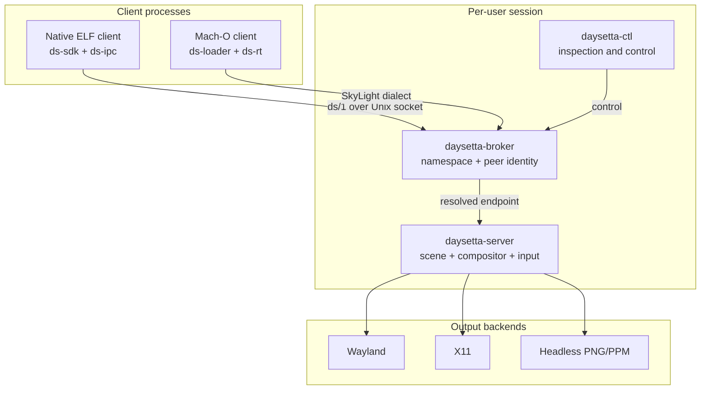
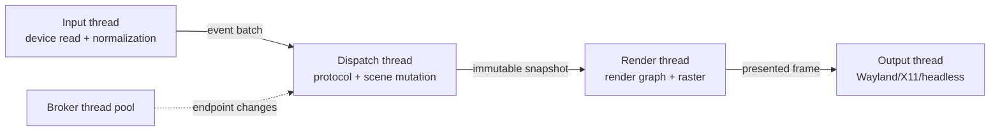
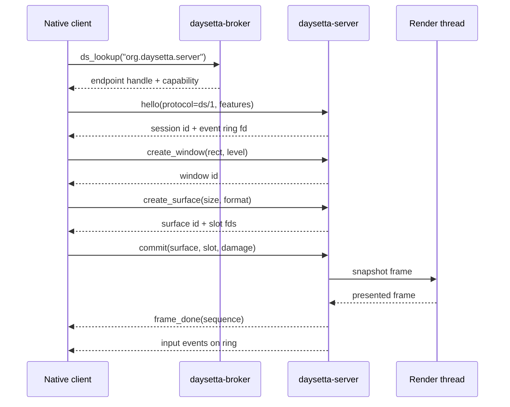
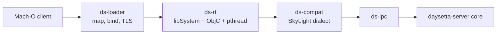

# Architecture

> Status: `PLANNED`. Every structural statement here describes intended DaySetta
> behaviour. Statements about Daylight carry an evidence class and a source.

## 1. Scope

DaySetta is a Linux user-space stack with two entry profiles:

* **Native** — ELF clients built against the DaySetta SDK, speaking the `ds/1` protocol.
* **Substrate** — Mach-O macOS 26.6 x86_64 clients loaded by `ds-loader` and served by
  `ds-rt`, speaking the SkyLight-shaped dialect through an adapter.

The same `daysetta-server` process serves both. The server owns windows, spaces,
surfaces, input, displays and material evaluation. It never owns Apple code.

## 2. System context

The broker is a name service and identity anchor, not a Mach bootstrap server. It
replaces `bootstrap_look_up` at the API boundary in the substrate and provides lookup
for native clients directly.

## 3. Process model

| Process | Lifetime | Owns | Threads | Status |
|---|---|---|---|---|
| `daysetta-broker` | Per user session | Namespace, endpoint table, peer credentials, capability checks | Event loop + worker pool | `PLANNED` |
| `daysetta-server` | Per session | Scene graph, surfaces, input routing, display state, render graph | Dispatch, render, input, output | `PLANNED` |
| `daysetta-session` | Per login | Environment, server lifetime, session metadata | Event loop | `PLANNED` |
| `daysetta-ctl` | On demand | Nothing persistent | Single | `PLANNED` |
| `daysetta-catalog` | Offline | Artifact readers only | Single | `PLANNED` |
| Client | Per app | Its own surfaces and event ring | App-defined | `PLANNED` |

Daylight used a single-threaded `mach_msg` receive loop with a 15 ms timeout and a
separate tick thread (`IMPLEMENTED`, `DAYLIGHT_ARCHITECTURE.md` §2). DaySetta keeps the
single-writer rule for scene state but moves rendering and input to dedicated threads,
because a Linux compositor cannot rely on a timeout-driven loop for frame pacing.

## 4. Layer model

| Layer | Name | Responsibilities | Must not |
|---|---|---|---|
| L0 | Platform | Linux syscalls, `epoll`, `memfd`, `eventfd`, `SCM_RIGHTS`, Wayland/X11 | Contain macOS policy |
| L1 | `ds-ipc` | Endpoint handles, rights, framing, fd passing, peer credentials | Interpret window semantics |
| L2 | `ds-protocol` | NDR/MIG subset, native IDL codec, validation | Touch the scene graph |
| L3 | Dialects | `ds/1` native; `skylight-26.6` compatibility | Share internal ids with L2 |
| L4 | Server core | Session, windows, spaces, surfaces, input, displays, notes | Render pixels |
| L5 | Render | Render graph, CPU/Vulkan backends, materials, output composition | Mutate scene state |
| L6 | Clients | SDK, substrate adapters, test clients | Bypass protocol |

The dependency rule is downward only. A dialect may call the server core; the server
core never calls a dialect. The renderer receives an immutable frame snapshot and
returns a fence plus a presented buffer.

## 5. Control plane and data plane

| Plane | Contents | Transport | Lifetime |
|---|---|---|---|
| Control | Requests, replies, notes, capability changes | Framed messages over a Unix socket | Per message |
| Surface | Pixel buffers, damage rectangles, buffer metadata | `memfd` + `SCM_RIGHTS`; optional `dma-buf` later | Per buffer epoch |
| Input | Pointer, keyboard, scroll, activation, text | Per-client shared ring + `eventfd` wakeup | Per session |
| Output | Composited frames | Wayland buffers, X11 SHM, headless files | Per frame |

Control messages never carry pixel payloads. Surfaces never carry protocol objects.
This separation is the main structural difference from Daylight's canvas path, where
the server allocated the canvas and the client wrote into it (`IMPLEMENTED`,
`DAYLIGHT_ARCHITECTURE.md` §4.2).

## 6. Memory model

* **Surface allocation** — the client creates a `memfd`, sets its size, and passes the
  descriptor. The server maps it read-only. Slot count is negotiated (two or three).
* **Presentation** — each commit names a slot, a damage list and a sequence number.
  The server validates the sequence before sampling the slot.
* **Compatibility surfaces** — the substrate adapter converts a Mach out-of-line
  memory descriptor into a `memfd` handle; the client is unaware of the translation.
* **Event rings** — one ring per client, fixed capacity, power-of-two, with a
  monotonic head/tail. Overflow is reported as a dropped-event counter, never as
  silent loss.
* **Scene snapshots** — immutable, reference-counted, produced on the dispatch thread
  and consumed by the render thread. No scene lock is held during rasterisation.
* **No Mach VM** — there is no `mach_vm_map`, no memory-entry port, and no kernel
  object behind a handle. A handle is a broker-issued identifier with explicit rights.

Pixel layout is negotiated, not assumed. The native default is premultiplied BGRA8888
with an explicit stride. The compatibility dialect accepts the BGRA layout Daylight
used (`stride = width * 4`, `IMPLEMENTED`, `DAYLIGHT_ARCHITECTURE.md` §4.1).

## 7. Threading model

| Rule | Reason |
|---|---|
| Only the dispatch thread mutates the scene graph | Removes lock ordering from the core |
| Render thread never reads mutable scene objects | A frame is a consistent snapshot |
| Input is normalized before it reaches the scene | Device quirks stay at the edge |
| Output never blocks dispatch | A slow display must not stall clients |
| Broker never touches pixels | Keeps the trusted name service small |

## 8. Native request flow

## 9. Substrate flow

The substrate inserts three adapters. `ds-rt` implements the libSystem-shaped calls a
Mach-O binary imports; `ds-loader` maps and binds the image; `ds-compat` translates the
SkyLight-shaped requests into server-core calls.

There is no Apple `dyld`, no dyld shared cache at runtime, and no Darling library. The
catalog readers are offline tools only; they are not part of the runtime path.

## 10. Failure model

| Failure | Detection | Response |
|---|---|---|
| Unknown protocol id | Router lookup | Typed `unsupported` reply; no process crash |
| Malformed message | Bounds, alignment, descriptor checks | Reject message, audit record, keep session |
| Client death | Peer credential and socket close | Release surfaces, windows and event ring |
| Surface sequence gap | Commit validation | Reject frame; request full damage |
| Render backend loss | Backend health check | Fall back to CPU or headless; mark degraded |
| Broker unavailable | Lookup failure | Client fails fast; server keeps existing sessions |
| Slow output | Frame queue depth | Drop oldest frame, report counter |

Daylight's containment rule was to answer with a Mach error instead of crashing
(`IMPLEMENTED`, `DAYLIGHT_ARCHITECTURE.md` §9). DaySetta keeps the principle but uses
typed protocol errors, because a Linux process cannot return Mach error codes from a
kernel trap it does not own.

## 11. Versioning

| Surface | Version carrier | Compatibility rule |
|---|---|---|
| Native protocol | `ds/1` major in the hello message | Major mismatch refused; minor features negotiated |
| SkyLight dialect | Release tag `skylight-26.6` | Exact release baseline; no silent fallback |
| Surface format | FourCC + stride + modifier | Unknown format refused before allocation |
| Config | Schema version in the file | Migration required, never guessed |
| Snapshot format | Renderer version | Golden frames tied to renderer version |

## 12. Deliberately absent

* Apple `dyld` and the dyld shared cache as execution inputs.
* Darling, XNU, `darlingserver`, and the dyld patch table.
* `launchd` and XPC service management. See `PROTOCOL_STRATEGY.md` §11.
* Private Objective-C ivar reads and class-name matching.
* `CASDFLayer`, `CASDFGenerator`, `CARenderShow` offset helpers and other Apple
  internals as dependencies. They remain documented evidence only.
* A Metal driver. Rendering targets CPU and Vulkan.

## 13. Open questions

| Question | Class | What settles it |
|---|---|---|
| Which Linux input backend is authoritative? | `UNKNOWN` | M1 ADR with a device-matrix test |
| Is `dma-buf` sharing required for the first GPU backend? | `UNKNOWN` | M4 backend prototype |
| How much of `libSystem` must `ds-rt` provide for a GUI client? | `UNKNOWN` | M4 ABI suite and import analysis |
| Can the SkyLight dialect be served without Mach port traps? | `PLANNED` | M3 replay against substrate adapters |
| What is the macOS 27 protocol delta? | `UNKNOWN` | M6 MIG scan and diff; see `RISKS.md` R3 |
