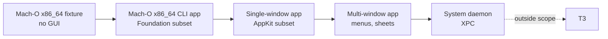

# Compatibility Scope

> Status: `PLANNED`. This document defines what DaySetta will and will not claim. It
> deliberately contains more exclusions than promises.

## 1. What "compatible" means

DaySetta uses four tiers. A tier is a claim about a class of clients, not a marketing
label. Every tier has an acceptance suite and a published limitation list.

| Tier | Client | Mechanism | Status |
|---|---|---|---|
| **T0** | Native Linux ELF client | DaySetta SDK + `ds/1` | `PLANNED` M2 |
| **T1** | Source-shaped client using DaySetta's public-shaped API | SDK objects modelled on public macOS concepts | `PLANNED` M2–M3 |
| **T2** | Unmodified macOS 26.6 x86_64 binary | `ds-loader` + `ds-rt` + SkyLight dialect | `PLANNED` M4–M5, narrow |
| **T3** | macOS system services and daemons | XPC / `launchd` / service graph | **Out of scope** |

T2 is a research target, not a promise. A GUI application pulls in AppKit,
CoreFoundation, CoreGraphics, QuartzCore, the Objective-C runtime and libdispatch. Each
of those is a project in its own right.

## 2. Release matrix

| Release | Evidence available | DaySetta claim |
|---|---|---|
| macOS 26.6 x86_64 | Full protocol inventory (738 routines), 303 841 exports, 24 473 ObjC classes, 344 184 selectors (`VERIFIED`) | The only compatibility baseline |
| macOS 27.0.1 arm64e | 4 574 612 exports; **0** ObjC class and selector names (`VERIFIED`, D-20); split cache | Catalog comparison only; **no runtime claim** |
| Other 26.x builds | Not catalogued | `UNKNOWN` |
| Apple Silicon runtime | No ABI work started | `UNKNOWN` |

The combined catalog holds **4 878 453 exported symbols** across the two releases. That
number describes what was read from artifacts, not what DaySetta implements.

macOS 27 is excluded from runtime claims for a concrete reason: the Objective-C
`__objc_classname` and `__objc_methname` sections are empty in that release, and the
cache pointer salt for class structures is only partially decoded (`OBSERVED`, D-21).
Without names, a class-level compatibility claim would be guesswork.

## 3. Surface matrix

| Surface | Daylight 26.6 | Daylight 27 | DaySetta target |
|---|---|---|---|
| Bootstrap aliases `com.apple.windowserver` / `.active` | `IMPLEMENTED` | `IMPLEMENTED` | T2 alias in broker |
| SkyLight handshake `600.0` | `IMPLEMENTED` | `UNKNOWN` | T2 |
| SkyLight routine inventory | `VERIFIED` 738 | `UNKNOWN` delta | T2 subset |
| Daylight real handlers | `IMPLEMENTED` 15 | — | T2 modelled subset |
| Canned replies | `IMPLEMENTED` | — | Removed from production |
| Window creation and ordering | `IMPLEMENTED` | `IMPLEMENTED` | T0/T1/T2 |
| Spaces | `PARTIAL` | `UNKNOWN` | T1/T2 partial |
| Fullscreen, tiling, Mission Control | `NOT IMPLEMENTED` | `NOT IMPLEMENTED` | Out of T0–T2 |
| Canvas transport | `IMPLEMENTED` | `IMPLEMENTED` | Replaced by surfaces |
| Input events | `IMPLEMENTED` | `IMPLEMENTED` | T0/T1/T2 |
| Text input / IME | `PARTIAL` | `PARTIAL` | T2 `UNKNOWN`, no T0 claim |
| Single display, 1920×1080 state | `IMPLEMENTED` | `IMPLEMENTED` | T0+ |
| Multiple displays / hot-plug | `NOT IMPLEMENTED` | `NOT IMPLEMENTED` | M6 research |
| `CARenderServer` host | `IMPLEMENTED` | `PARTIAL` | T2 adapter |
| CA layer-tree capture | `IMPLEMENTED` | `PARTIAL` | T2 narrow |
| Glass material | `PARTIAL` 0.37-gray fill | `UNKNOWN` | T0/T1 material model |
| Metal device | `IMPLEMENTED` stand-in | `IMPLEMENTED` stand-in | Vulkan backend, no Metal |
| AppKit view drawing | `IMPLEMENTED` | `PARTIAL` | T2 narrow |
| `NSViewBackingLayerContents` | `IMPLEMENTED` | `PARTIAL` | T2 adapter or unsupported |
| Foundation / CoreFoundation | `IMPLEMENTED` via Darling | `IMPLEMENTED` | T2 measured imports only |
| Objective-C runtime | `IMPLEMENTED` via Darling | `IMPLEMENTED` | T2 `ds-rt` runtime |
| libdispatch | `IMPLEMENTED` via Darling | `IMPLEMENTED` | T2 subset |
| Accessibility query | `PARTIAL` | `PARTIAL` | Explicit appearance setting |
| XPC | `NOT IMPLEMENTED` | `NOT IMPLEMENTED` | **Excluded** |
| `launchd` | `NOT IMPLEMENTED` | `NOT IMPLEMENTED` | **Excluded** |
| `logd`, `cfprefsd`, `fontd`, `distnoted` | `NOT IMPLEMENTED` | `NOT IMPLEMENTED` | **Excluded** |
| DNS-SD, mount, rootfs stand-ins | `IMPLEMENTED` | `IMPLEMENTED` | Not carried |

## 4. T2 application class

The first T2 claim is deliberately narrow. It is a capability envelope, not a list of
brands.

| Envelope | Allowed dependencies | Evidence required |
|---|---|---|
| E0 | None beyond `ds-rt` core | ABI suite |
| E1 | Foundation/CoreFoundation subset, ObjC runtime | Import census per binary |
| E2 | AppKit single window, CoreGraphics raster, basic events | Golden frame and interaction test |
| E3 | Multi-window, menu, sheet, popover, text editing | Scenario suite |
| E4 | Any XPC, `launchd`, system daemon | Not attempted |

## 5. Explicit exclusions

* **No macOS 27 runtime.** Catalog only.
* **No XPC and no `launchd`.** The broker is not an XPC service manager.
* **No Apple binary redistribution.** Clients, caches, dylibs, fonts are user-supplied
  and never committed.
* **No Metal.** A Vulkan renderer is planned; `MTLCreateSystemDefaultDevice` is not a
  supported compatibility surface for unmodified clients in M4.
* **No private Objective-C ivar contracts.** `_sdfElementContents`, `_imageLayer`,
  `contextId` KVC reads and class-name matching are retired.
* **No code-signing, sandbox or AMFI equivalence.**
* **No full CoreText/font service.** Text support is a separate ADR.
* **No multi-seat, remote display, or virtual display guarantee.**
* **No bit-exact Apple visual output.** Material parity is structural and perceptual.

## 6. Claim discipline

| Claim type | Allowed wording | Required evidence |
|---|---|---|
| Protocol shape | "implements the observed shape of routine X" | Transcript or source citation |
| Handler behaviour | "modelled" | Unit test and trace replay |
| Application support | "runs fixture category E2" | Named fixture and test log |
| Visual output | "passes material threshold" | Golden manifest and metric |
| Release support | "macOS 26.6 x86_64 baseline" | Catalog pin and checksum |

Forbidden wording: "supports macOS", "runs AppKit apps", "glass is implemented",
"100 % protocol compatible", or any phrase that hides the tier. The compatibility
matrix in the README is the public summary; this document is the contract.

## 7. Acceptance per tier

| Tier | Acceptance | Exit gate |
|---|---|---|
| T0 | SDK sample creates a window, commits a surface, receives input | M2 |
| T1 | Three source-shaped samples compile unchanged against the SDK | M3 |
| T2/E0 | Mach-O CLI fixture exits 0 without Apple `dyld` | M4 |
| T2/E1 | Foundation-shaped fixture reads files, threads and time | M4 |
| T2/E2 | Single-window app draws and responds to pointer and keyboard | M5 |
| T2/E3 | Scenario suite passes with a published unsupported list | M6 |
| T3 | — | Not attempted |

## 8. Unknowns that change scope

| Unknown | Effect if unfavourable |
|---|---|
| macOS 27 protocol delta | T2 stays pinned to 26.6 indefinitely |
| `libSystem` import breadth for AppKit | E2 slips past M5 or is dropped |
| ObjC runtime licensing | Substrate blocked at M4 |
| Font availability and licensing | Text in E2/E3 becomes client-supplied glyphs only |
| Vulkan driver quality on CI | GPU path is optional; CPU remains reference |
| Probe hardware availability | Trace corpus stops growing; replay coverage freezes |

## 9. Audit trail

Every release publishes a `compatibility.json` with: tier, release baseline, modelled
routine ids, unsupported routine ids, fixture results, renderer version and known
exclusions. The file is generated from the test run, not edited by hand. A tier claim
without a matching audit record is treated as a documentation bug.
