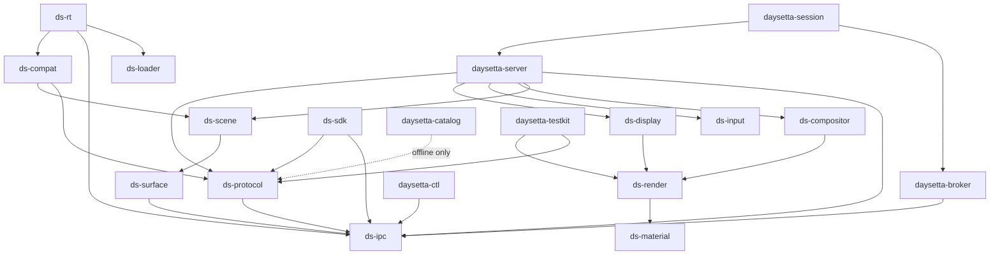
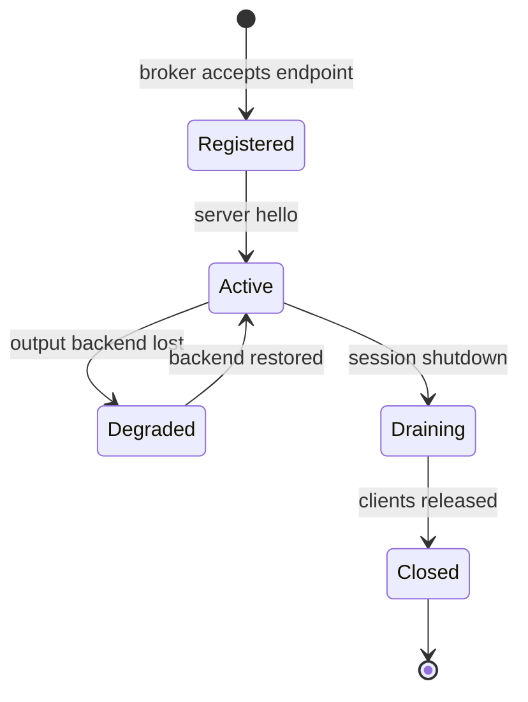

# Component Map

> Status: `PLANNED`. Components, interfaces and milestones are design intent. Daylight
> citations are evidence about the predecessor.

## 1. Conventions

* A **process** has its own lifetime and trust boundary. A **library** is linked into a
  process. A **tool** runs offline.
* Every component has one owner document and one milestone gate. Interfaces are
  versioned; internal headers are not.
* Implementation languages are an M0 decision (ADR-0002). The interfaces below are
  language-neutral on purpose.

## 2. Component inventory

| Component | Kind | Responsibility | Interfaces | Milestone | Status |
|---|---|---|---|---|---|
| `daysetta-broker` | Process | Endpoint namespace, peer identity, capability issue/revoke | `ds-ipc` control protocol | M1 | `PLANNED` |
| `daysetta-server` | Process | Session host, dispatch, lifecycle, admission control | Native + compatibility dialects | M1 | `PLANNED` |
| `ds-scene` | Library | Windows, spaces, levels, ordering, notes | Server-internal C ABI | M2 | `PLANNED` |
| `ds-surface` | Library | Surface pool, slots, damage, sequence validation | `ds-ipc` fd passing | M2 | `PLANNED` |
| `ds-input` | Library | Device normalization, pointer/keyboard/scroll, activation | Event-ring writer | M2 | `PLANNED` |
| `ds-display` | Library | Display topology, mode state, frame pacing | Output backend interface | M2 | `PLANNED` |
| `ds-compositor` | Library | Layer composition, ordering, damage accumulation | `ds-render` API | M2 | `PLANNED` |
| `ds-render` | Library | Render graph, CPU backend, Vulkan backend | Backend vtable | M2 / M5 | `PLANNED` |
| `ds-material` | Library | SDF shapes, backdrop sampling, blur, tint, highlight, border | Render-graph nodes | M5 | `PLANNED` |
| `ds-ipc` | Library | Message framing, handles, rights, fd passing, peer checks | Unix socket + `memfd` | M1 | `PLANNED` |
| `ds-protocol` | Library | IDL, NDR/MIG subset, validation, generated stubs | Codec API | M1 / M3 | `PLANNED` |
| `ds-compat` | Library | SkyLight dialect mapping to server core | `ds-protocol` + `ds-scene` | M3 | `PLANNED` |
| `ds-loader` | Library | ELF and Mach-O mapping, binding, TLS, relocations | Loader API | M1 / M4 | `PLANNED` |
| `ds-rt` | Library | libSystem-shaped ABI, ObjC runtime, pthread, dispatch subset | POSIX-shaped ABI | M4 | `PLANNED` |
| `ds-sdk` | Library | Native client API, surface helpers, event decoding | `ds/1` | M2 | `PLANNED` |
| `daysetta-session` | Process | Session environment, server launch, state directory | Broker + server | M2 | `PLANNED` |
| `daysetta-ctl` | Tool | Inspect scene, traces, counters; request dumps | Control endpoint | M2 | `PLANNED` |
| `daysetta-catalog` | Tool | Offline readers for caches, exports, ObjC sections, MIG stubs | File artifacts only | M0 | `PLANNED` |
| `daysetta-testkit` | Library + tool | Transcript replay, golden frames, fault injection | Test-only | M0 | `PLANNED` |
| `ds-observability` | Library | Structured logs, trace ring, counters, crash notes | Process-wide | M1 | `PLANNED` |
| `ds-security` | Library | Capabilities, peer checks, path and fd hygiene | `ds-ipc` hooks | M1 | `PLANNED` |
| `ds-config` | Library | Versioned configuration, defaults, validation | Config schema | M1 | `PLANNED` |
| `ds-shell` | Library | Optional reference desktop: menu bar, wallpaper, demo tiles | `ds-scene` | M2 | `PLANNED` |

Daylight's desktop shell was a software rasteriser for menu bar, Dock tiles and
wallpaper (`IMPLEMENTED`, `DAYLIGHT_ARCHITECTURE.md` §7). In DaySetta the shell is
optional and sits on top of the scene API; it is never required for a client window to
appear.

## 3. Dependency graph

Solid edges are runtime dependencies. The dashed edge is an offline dependency and may
never appear in a production process.

## 4. Ownership boundaries

| Boundary | Owner | Contract | Forbidden crossing |
|---|---|---|---|
| Client ↔ broker | `ds-ipc` | Lookup, handle, capabilities | Client never learns another client's endpoint |
| Broker ↔ server | `ds-ipc` | Registration, revocation, peer identity | Server never trusts a client-supplied pid |
| Server ↔ render | `ds-render` | Immutable snapshot in, frame out | Renderer never mutates scene state |
| Dialect ↔ core | `ds-protocol` | Validated request objects | Dialect never reaches into scene structs |
| Loader ↔ runtime | `ds-loader` | Mapped image + symbol table | Loader never executes Apple code |
| Runtime ↔ compat | `ds-rt` | POSIX-shaped calls and bootstrap lookup | Runtime never links Darling or Apple `dyld` |

## 5. Interface schemas

| Schema | Contents | Versioned by | Validation |
|---|---|---|---|
| Endpoint record | Name, owner uid, capabilities, protocol set | Broker schema | Strict parse, no extra fields |
| Message header | Size, id, flags, handle count, sequence | `ds/1` and dialect tag | Bounds, alignment, count limits |
| Surface descriptor | Width, height, stride, format, slot count | FourCC + schema | Dimension limits, overflow checks |
| Commit record | Surface id, slot, damage list, sequence | Per surface epoch | Monotonic sequence |
| Event record | Type, timestamp, target, payload | Event schema | Range and enum checks |
| Trace record | Normalized request/reply or input/output event | Test schema | Deterministic normalization |

## 6. Component state machines

The server never returns to `Registered` in place. A restart creates a new endpoint and
a new session id, so clients cannot confuse an old capability with a new process.

## 7. What each component must not become

| Component | Tempting scope | Why it is rejected |
|---|---|---|
| `daysetta-server` | Full macOS service manager | Draws in launchd/XPC scope, out of tier |
| `ds-rt` | A full libSystem clone | Unbounded ABI surface; grows by measured imports only |
| `ds-compat` | Byte-for-byte MIG emulator for all 738 routines | 15 handlers were real in Daylight; the rest need evidence, not guesses |
| `ds-loader` | A general-purpose binary translator | Loader maps and binds; it does not rewrite semantics |
| `ds-render` | A GPU driver | Backends consume standard Linux interfaces only |
| `daysetta-catalog` | A runtime dependency | Offline analysis must never gate a client |

## 8. Milestone ownership

| Milestone | Components introduced | Components extended |
|---|---|---|
| M0 | `daysetta-catalog`, `daysetta-testkit` | — |
| M1 | `daysetta-broker`, `daysetta-server`, `ds-ipc`, `ds-protocol`, `ds-loader`, `ds-rt`, `ds-security`, `ds-config`, `ds-observability` | Catalog readers |
| M2 | `ds-scene`, `ds-surface`, `ds-input`, `ds-display`, `ds-compositor`, `ds-render`, `ds-sdk`, `daysetta-session`, `daysetta-ctl`, `ds-shell` | Protocol, loader |
| M3 | `ds-compat` | Protocol, scene, testkit |
| M4 | — | Loader, runtime, security |
| M5 | `ds-material` | Render, compat, testkit |
| M6 | — | All; packaging and operations |

## 9. Open decisions

| Decision | Needed by | Options | Owner doc |
|---|---|---|---|
| Implementation language per component | M0 | C11, C++20, Rust, mixed | ADR-0002 |
| Input backend | M1 | evdev, libinput, compositor-provided | `ARCHITECTURE.md` §13 |
| GPU buffer sharing | M4 | `dma-buf`, copies only | `RENDERING_STRATEGY.md` |
| ObjC runtime source | M4 | independent runtime, Apple OSS under licence | `RISKS.md` R5 |
| Shell scope | M2 | demo only, none | `COMPATIBILITY_SCOPE.md` |
