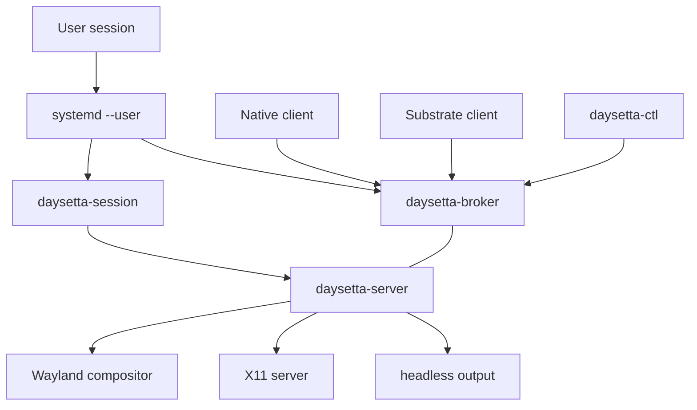

# Deployment

> Status: `PLANNED`. Nothing in this document has been shipped. Commands and paths are
> proposed and must be confirmed by the M1 deployment ADR.

## 1. Deployment profiles

| Profile | Processes | Output | Client type | Status |
|---|---|---|---|---|
| `native` | Broker, server, session | Wayland or X11 | ELF / `ds/1` | `PLANNED` M2 |
| `substrate` | Broker, server, session, client runtime | Wayland or X11 | Mach-O / SkyLight dialect | `PLANNED` M5 |
| `headless` | Broker, server | PNG/PPM or none | Test clients | `PLANNED` M2 |
| `dev` | All of the above, debug logging | Any | Any | `PLANNED` M1 |

Profiles share one server binary. The profile selects dialect aliases, output backend
and logging defaults; it never selects a different scene or renderer.

## 2. Artifacts

| Artifact | Kind | Installed to | Notes |
|---|---|---|---|
| `daysetta-broker` | Executable | `/usr/libexec/daysetta/` | Per-user service |
| `daysetta-server` | Executable | `/usr/libexec/daysetta/` | One per session |
| `daysetta-session` | Executable | `/usr/libexec/daysetta/` | Optional |
| `daysetta-ctl` | Executable | `/usr/bin/` | User tool |
| `daysetta-catalog` | Executable | `/usr/bin/` | Offline only |
| `libds-sdk` | Library + headers | `/usr/lib/daysetta/` | Native clients |
| `libds-rt` | Library | `/usr/lib/daysetta/` | Substrate only |
| `libds-loader` | Library | `/usr/lib/daysetta/` | Substrate only |
| Config schema | Data | `/usr/share/daysetta/` | Versioned |
| Systemd units | Unit files | `/usr/lib/systemd/user/` | Linux integration |

No Apple binary, dylib, cache or font is part of any artifact.

## 3. Runtime topology



The broker and server are separate processes so a server crash does not destroy the
namespace. The broker never holds pixels and never renders.

## 4. Linux requirements

| Requirement | Why | Status |
|---|---|---|
| Linux with `epoll`, `eventfd`, `memfd_create`, `SCM_RIGHTS` | Transport and surfaces | `PLANNED` |
| Unix domain sockets with peer credentials | Identity | `PLANNED` |
| Wayland or X11 client libraries | Output | `PLANNED` |
| Vulkan loader and a conformant driver | Optional GPU backend | `PLANNED` M5 |
| A C toolchain and the chosen runtime | Build and `ds-rt` | `PLANNED` |
| User namespaces or a clean session environment | Isolation | `UNKNOWN` |

The exact minimum kernel version is pinned by the M1 ADR after testing. No kernel
module, patch or setuid helper is required.

## 5. Install layout

| Path | Contents | Writable by |
|---|---|---|
| `/usr/libexec/daysetta/` | Server-side executables | Package manager |
| `/usr/lib/daysetta/` | SDK, runtime, loader libraries | Package manager |
| `/usr/share/daysetta/` | Schemas, presets, documentation | Package manager |
| `/etc/daysetta/` | System configuration | Administrator |
| `$XDG_RUNTIME_DIR/daysetta/` | Sockets, pid files, event rings | User |
| `$XDG_STATE_HOME/daysetta/` | Logs, counters, crash notes | User |
| `$XDG_CACHE_HOME/daysetta/` | Frame dumps, trace captures | User |

Runtime files are created with user-only permissions. A socket in a world-writable
directory is a release blocker.

## 6. Configuration

A single versioned config file selects profile, output backend, renderer, limits and
logging. Precedence is: command line, environment, user config, system config, built-in
defaults. Unknown keys are errors, not warnings, so a typo cannot silently change
behaviour.

```toml
# Proposed shape; schema is owned by ds-config.
schema = 1

[profile]
name = "native"

[output]
backend = "wayland"

[render]
backend = "cpu"
threads = 0

[limits]
max_clients = 64
max_surfaces_per_client = 256
max_surface_bytes = 268435456
```

The example is illustrative. The authoritative schema is generated from the config
library and validated in CI.

## 7. Service management

| Unit | Scope | Restart | Notes |
|---|---|---|---|
| `daysetta-broker.service` | User | On failure | Starts before server |
| `daysetta-session.service` | User | On failure | Environment and state dir |
| `daysetta-server.service` | User | On failure | Binds after broker |
| `daysetta-server@.service` | User | On failure | Alternate profile instance |

The server exits non-zero on a fatal configuration error and zero on a clean session
shutdown. A crash loop is bounded by systemd's restart policy; the broker keeps the
namespace and reports the restart.

## 8. Security model

| Boundary | Control |
|---|---|
| Client ↔ broker | Peer credentials, explicit capabilities, per-session namespace |
| Client ↔ server | Broker-issued handle, capability checked on every request |
| Server ↔ output | Ordinary Wayland/X11 client permissions |
| Server ↔ filesystem | No ambient file access beyond configured state and cache |
| Surface memory | `memfd` with size limits; server maps read-only |
| Control tool | Same user; privileged operations require an explicit capability |
| Substrate loader | No code signing claim; untrusted binaries are not sandboxed by DaySetta |

DaySetta does not claim AMFI, code-signing, sandbox or quarantine equivalence. Those
are macOS security services, not window-server features.

## 9. Upgrade and rollback

| Step | Rule |
|---|---|
| Pre-flight | Read config schema; refuse a newer schema than the binary supports |
| Drain | Stop accepting clients; keep existing sessions until they exit or timeout |
| Replace | Atomic rename of binaries and libraries |
| Migrate | Run the config migration only if declared reversible |
| Verify | Start broker, then server; run the health check |
| Rollback | Restore the previous artifact set and schema; never downgrade state in place |

Protocol major changes require a new endpoint name or an explicit negotiation failure.
There is no "best effort" downgrade.

## 10. Observability

| Signal | Sink | Retention |
|---|---|---|
| Structured logs | `$XDG_STATE_HOME/daysetta/log/` | 7 days default |
| Trace ring | Memory, dumped on request | Last 64 MiB |
| Counters | `daysetta-ctl counters` | Process lifetime |
| Frame manifest | Headless output directory | Per run |
| Crash note | State directory | Until acknowledged |

Logs never contain surface pixels, client file contents or Apple binary paths. A trace
may contain window titles; capture is opt-in.

## 11. Headless and container use

Headless mode requires no display server and writes a manifest plus frames. It is the
primary CI mode. Containers are supported for tests only; a container deployment must
mount a runtime directory and must not expose the broker socket outside the container.

## 12. Failure handling

| Symptom | First check | Action |
|---|---|---|
| Client cannot find server | Broker log, socket permissions | Restart session unit |
| Black frame | Output backend, renderer fallback counter | Switch to CPU/headless |
| Input lost | Event ring overflow counter | Increase ring or reduce client rate |
| Server restart loop | Config schema, state directory ownership | Fix config; clear stale pid |
| Substrate client aborts | Crash note, import census | Mark unsupported or add a measured shim |

## 13. Release checklist

- [ ] Artifacts built reproducibly and signed by the distribution channel.
- [ ] No Apple binary, dylib, cache or font in the package.
- [ ] Config schema and migration tested.
- [ ] Compatibility audit file generated from the release test run.
- [ ] Unsupported list published with the release notes.
- [ ] Rollback tested from the previous release.
- [ ] Security review closed for new IPC surface.
