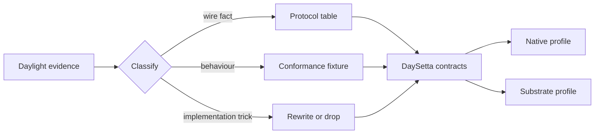

# Migration from Daylight

> Status: `PLANNED`. This is a migration plan, not a record of work done. The Daylight
> column cites evidence from the predecessor; the DaySetta column is intent.

## 1. What migrates

DaySetta inherits four classes of asset from Daylight:

| Asset | Form | Treatment |
|---|---|---|
| Protocol knowledge | 738-routine inventory, 9 subsystems, observed constants | Port as declarative data |
| Behavioural evidence | Traces, implementation status, technical discoveries | Keep as test fixtures and citations |
| Tooling knowledge | Offline cache reader, catalog builder, probe format | Reimplement under `daysetta-catalog` |
| Code patterns | Dispatch, session, input encoding, compositing semantics | Rewrite against the new architecture |

Everything else — Darling integration, the injected bridge, private-API interposition,
canned production replies — is retired.

## 2. Feature migration table

| Daylight feature | Daylight evidence | DaySetta owner | Status |
|---|---|---|---|
| 738-routine SkyLight inventory | `VERIFIED`, `protocol/macos-26.6-x86_64.json` | `ds-protocol` | `PLANNED` — port as data |
| 732-entry generated dispatch table | `IMPLEMENTED`, `server/src/dl_routines.c` | `ds-protocol` | `PLANNED` — regenerate |
| Complex descriptor and NDR parsing | `IMPLEMENTED`, `dispatch.c:91-134` | `ds-protocol` | `PLANNED` — replace with generated codec |
| Reply builder for ports and OOL data | `IMPLEMENTED`, `main_darling.c:288-380` | `ds-ipc` | `PLANNED` — replace |
| Canned replies for unimplemented routines | `IMPLEMENTED`, `dl_canned.c` | `daysetta-testkit` | `PLANNED` — retire from production |
| Reply size tables from SkyLight buffers | `IMPLEMENTED`, `dl_reply_sizes.c` | `ds-protocol` | `PLANNED` — retire as schema |
| Call-frequency JSON trace | `IMPLEMENTED`, `dispatch.c:69-85` | `ds-observability` | `PLANNED` — port format |
| Handshake returning `600.0` | `IMPLEMENTED`, `session.c:25-36` | `ds-compat` | `PLANNED` — port constants |
| Connection id `0x1103`, sequence `0x1000` | `VERIFIED`, D-03 | `ds-compat` | `PLANNED` — port constants |
| `logged_in = 1` launch-policy bypass | `IMPLEMENTED`, `session.c:21-24` | `ds-compat` | `PLANNED` — model explicitly |
| `CreateWindow` with `0x1f6`, tag, `0xb0` shm | `IMPLEMENTED`, `window.c:14-16` | `ds-scene` | `PLANNED` — replace layout |
| `SetWindowLayerContext` and visibility notes | `IMPLEMENTED`, `window.c:94-131` | `ds-scene` | `PLANNED` — port semantics |
| `SetTransactionCompletion` | `IMPLEMENTED`, `window.c:133-151` | `ds-scene` | `PLANNED` — port semantics |
| `WindowIsOrderedIn` / `CopySpacesForWindows` | `IMPLEMENTED`, `window.c:153-190` | `ds-scene` | `PLANNED` — port semantics |
| Spaces membership tracking | `PARTIAL`, note `0x33b` | `ds-scene` | `PLANNED` — complete or document |
| Single 1920×1080 display state | `IMPLEMENTED`, `dl_display_state.c` | `ds-display` | `PLANNED` — replace format |
| Multi-display and hot-plug | `NOT IMPLEMENTED` | `ds-display` | `PLANNED` — M6 research |
| Canvas attach / flush / detach | `IMPLEMENTED`, `bridge.c:13-40` | `ds-surface` | `PLANNED` — replace with slots |
| Private bridge ids `0x44594c01..ff` | `VERIFIED`, `daylight/docs/knowledge/api/ipc-interface-catalog.md` | `daysetta-testkit` | `PLANNED` — test-only translator |
| Composite by level, then flush order | `IMPLEMENTED`, commit `a9545d4` | `ds-compositor` | `PLANNED` — port semantics |
| Shared framebuffer file with header | `IMPLEMENTED`, `main_darling.c:167-192` | `ds-display` | `PLANNED` — replace with backend |
| X11 front end | `IMPLEMENTED`, `frontends/x11` | `ds-display` | `PLANNED` — reimplement as backend |
| Desktop shell with menu bar and Dock tiles | `IMPLEMENTED`, `shell.c` | `ds-shell` | `PLANNED` — optional demo only |
| CA daemon hosting `com.apple.CARenderServer` | `IMPLEMENTED`, `ca/daylight-ca.m:501-506` | `ds-compat` + `ds-render` | `PLANNED` — replace host model |
| `CARenderServer*` / `CARenderContext*` calls | `IMPLEMENTED`, `ca/daylight-ca.m:309-366` | `ds-compat` | `PLANNED` — reimplement contract |
| `CARenderShow` offset helpers | `IMPLEMENTED`, high risk | — | `PLANNED` — drop |
| `CAContext` / `CATransaction` swizzles | `IMPLEMENTED`, `daylight/docs/knowledge/api/private-api-research.md` §3.2 | `ds-compat` | `PLANNED` — replace with commit adapter |
| `NSViewBackingLayerContents` rendering | `IMPLEMENTED`, commit `5bc8009` | `ds-compat` | `PLANNED` — narrow adapter or unsupported |
| CASDF glass and 0.37-gray fallback | `PARTIAL` / `OBSERVED`, D-13 | `ds-material` | `PLANNED` — replace with material graph |
| Metal stand-in device | `IMPLEMENTED`, `bridge/daylight-bridge.m:51-101` | `ds-render` | `PLANNED` — replace with Vulkan |
| AX reduce-transparency interposition | `IMPLEMENTED`, D-10 | `ds-config` | `PLANNED` — explicit appearance setting |
| Tagged CoreGraphics event encoding | `VERIFIED`, D-07 | `ds-input` + `ds-compat` | `PLANNED` — port codec |
| Server-synthesised drag events | `IMPLEMENTED`, `input.c:286-287` | `ds-input` | `PLANNED` — port semantics |
| Event targeting and activation | `IMPLEMENTED`, `input.c:193-232` | `ds-input` | `PLANNED` — port semantics |
| Realtime display block, 4 096 B at 16.666 667 ms | `VERIFIED`, D-09 | `ds-display` | `PLANNED` — port codec |
| Text input and IME | `PARTIAL` | `ds-input` | `UNKNOWN` — no first-release claim |
| DNS-SD, mount, rootfs stand-ins | `IMPLEMENTED`, `services/` | — | `PLANNED` — retire |
| Darling `libsystem_kernel` and `libdispatch` overrides | `VERIFIED`, handoff | `ds-rt` | `PLANNED` — replace with own ABI |
| `launchd` / XPC service gap | `NOT IMPLEMENTED`, empty catalog | `daysetta-broker` only | `PLANNED` — remain out of scope |
| Offline Mach-O and cache readers | `IMPLEMENTED`, `tools/apicatalog` | `daysetta-catalog` | `PLANNED` — port and re-license-check |
| Mac probe clients (`wsprobe2`, `hello2`) | `IMPLEMENTED`, `tools/macprobe` | `daysetta-testkit` | `EVIDENCE ONLY` |
| PNG writer and debug frame dumps | `IMPLEMENTED`, `bridge.c` | `daysetta-testkit` | `PLANNED` — port as test feature |

## 3. Keep as evidence, not as code

| Artifact | Why it stays | Where it belongs |
|---|---|---|
| Protocol JSON and MIG inventory | It is the only complete 26.6 map | `daysetta-catalog` fixtures |
| Implementation status tables | They prevent repeating failed approaches | Migration notes and tests |
| Technical discoveries D-01…D-30 | Many are negative results worth preserving | Evidence index |
| Private-API research | It records what not to reintroduce | Risk register and migration table |
| Trace corpus | It is the conformance input | External artifact store, checksummed |

## 4. Retire, do not port

| Retired pattern | Reason |
|---|---|
| Dylib injection into AppKit clients | Depends on private classes and process layout |
| Private ivar reads | Silent breakage on release change |
| Offset arithmetic from exported symbols | Release-specific and unsafe |
| Canned replies in production | Hides missing behaviour and cannot be tested semantically |
| Mach ports as kernel objects | DaySetta has no Mach kernel; handles are broker-issued |
| Darling and `dyl4` deployment | The substrate is DaySetta-owned, not Darling-owned |
| Shared framebuffer file as the only output | It couples capture and presentation |

## 5. New capabilities Daylight did not have

| Capability | Owner | Status |
|---|---|---|
| Native `ds/1` protocol | `ds-protocol` | `PLANNED` |
| Capability-based endpoint model | `ds-security` | `PLANNED` |
| Immutable frame snapshots | `ds-compositor` | `PLANNED` |
| First-class material graph | `ds-material` | `PLANNED` |
| Vulkan backend | `ds-render` | `PLANNED` |
| Deterministic golden-frame suite | `daysetta-testkit` | `PLANNED` |
| Multi-display topology model | `ds-display` | `PLANNED` M6 |
| Compatibility audit file | `daysetta-testkit` | `PLANNED` |

## 6. Migration order

1. Port the catalog and protocol data; do not port the server.
2. Build the native transport and scene graph; prove T0.
3. Serve the SkyLight dialect from recorded traces; prove T2 protocol shape.
4. Build the loader and runtime; prove E0 and E1.
5. Add AppKit-shaped rendering and materials; prove E2.
6. Publish the unsupported list before claiming E3.

## 7. Migration risks

| Risk | Trigger | Response |
|---|---|---|
| Evidence gap for a routine | A fixture needs an unrecorded behaviour | Mark unsupported; do not guess |
| Temptation to reuse canned replies | A client blocks during M3 | Keep fixture-only mode behind a test flag |
| Scope creep into Darling repair | A substrate crash looks like a kernel bug | Fix in `ds-rt` or declare unsupported |
| Private-API regression | A visual only works via an ivar | Treat as a design failure; redesign the material |
| Tool licence mismatch | Catalog code cannot be reused | Rewrite the reader from the format spec |
