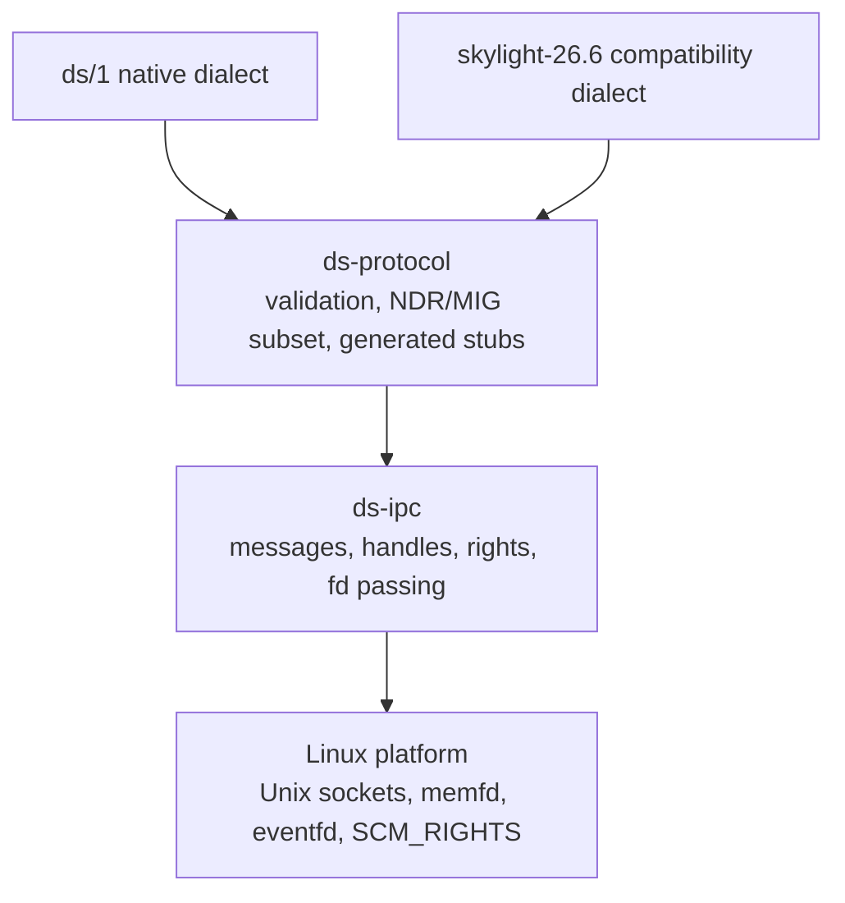

# Protocol Strategy

> Status: `PLANNED`. The protocol layers below are intended DaySetta designs. The
> DaySetta-owned names (`ds/1`, `ds_e_*`, `org.daysetta.*`) are proposals, not Apple
> APIs. Daylight facts are cited with evidence classes.

## 1. Goals

The protocol must make the server's behaviour testable without a macOS guest, keep the
compatibility dialect honest about what it does not reproduce, and never require an
Apple loader or a Mach kernel trap.

| Goal | Consequence |
|---|---|
| One codec, two dialects | Native `ds/1` and `skylight-26.6` share validation and framing |
| Typed errors | Clients can distinguish unsupported, invalid, denied and transient |
| Explicit capabilities | A client cannot address an endpoint it was not granted |
| Deterministic transcripts | Replay is possible with ports, pids and timestamps normalized |
| No opaque canned replies in production | Every answer is modelled or explicitly unsupported |

## 2. Layered stack

A dialect owns naming and semantics. The codec owns bytes. The transport owns
delivery and identity. No layer above the transport may assume a Mach port exists.

## 3. Transport

### 3.1 Message header

| Field | Width | Meaning |
|---|---|---|
| `magic` | 32 bits | `DSM1` |
| `size` | 32 bits | Total bytes including header |
| `op` | 32 bits | Dialect-scoped operation id |
| `flags` | 32 bits | Reply, one-way, error, handle-bearing |
| `sequence` | 64 bits | Monotonic per endpoint |
| `handle_count` | 16 bits | Number of passed descriptors |
| `reserved` | 16 bits | Must be zero |
| `payload_len` | 32 bits | Payload bytes after the handle table |

Handles are indices into a per-endpoint table held by the broker. A handle is not a
kernel object and carries no ambient authority; rights are explicit (`send`, `receive`,
`dup`, `revoke`).

### 3.2 Compatibility constraints

Daylight's dispatcher accepted at most four port descriptors, required descriptor type
`0` at byte 11, used a 12-byte port descriptor and an 8-byte NDR record, and computed
the inline data pointer as `4 + count*12 + 8` (`VERIFIED`, `server/src/dispatch.c:87-110`).
The compatibility dialect must preserve those observed shapes where a client depends
on them. The native dialect does not inherit them.

## 4. Codec

| Concern | Native `ds/1` | SkyLight dialect |
|---|---|---|
| Encoding | Little-endian, fixed header, typed fields | NDR subset as observed in Daylight traces |
| Port references | Handle table | Handle table translated by `ds-compat` |
| Out-of-line data | `memfd` + `SCM_RIGHTS` | Descriptor translated to `memfd` |
| Endianness | Little-endian only | Both byte orders accepted where the observed client used a big-endian variant (`VERIFIED`, D-07) |
| Validation | Bounds, alignment, enum range, count limits | Same, plus Apple-shaped reply-id check |
| Unknown fields | Rejected | Ignored only where recorded traces require it |

The codec is generated from two declarative sources: a native IDL for `ds/1`, and a
subsystem table derived from the 738-routine inventory for the compatibility dialect.
Generated code is checked in and reviewed; the generator is not a runtime dependency.

## 5. Dialects

### 5.1 `ds/1` — native

| Operation class | Examples | Semantics |
|---|---|---|
| Session | `hello`, `bye`, `ping` | Version negotiation, capability list |
| Window | `create_window`, `destroy_window`, `configure` | Scene object lifecycle |
| Surface | `create_surface`, `commit`, `release` | Buffer ownership and damage |
| Input | `set_focus`, `grab`, `set_cursor` | Routing and capture |
| Display | `enumerate`, `set_mode` | Topology and pacing |
| Control | `dump_scene`, `get_counters` | Diagnostic only, capability-gated |

Operation ids are stable within a major version and never reused. Unknown ids return
`ds_e_unsupported`. One-way operations are explicit in `flags`; a one-way operation has
no reply. Replies carry the originating sequence number.

### 5.2 `skylight-26.6` — compatibility

The baseline is the macOS 26.6 x86_64 inventory: **738 MIG routines in 9 subsystems**
(`VERIFIED`, `protocol/macos-26.6-x86_64.json`). Id ranges are disjoint by subsystem.

| Subsystem | Routines | Id range | Direction | DaySetta intent |
|---|---|---|---|---|
| `CGXRendezvous` | 41 | 29 000–29 040 | client → server | Handshake subset first |
| `CGXServices` | 575 | 30 000–30 636 | client → server | Model only observed operations |
| `CGXWindowServer` | 72 | 32 000–32 073 | client → server | Window and connection subset |
| `ServicesRelocated` | 29 | 33 000–33 028 | client → server | Catalogue; no early modelling |
| `ServerRelocated` | 10 | 34 000–34 009 | client → server | Catalogue; no early modelling |
| `CGXHMD` | 5 | 35 000–35 004 | client → server | Out of scope until M6 |
| `CGYSpinControl` | 2 | 1–2 | server → client reply | Reply-only; not dispatched |
| `CGYCaptureReply` | 2 | 1–2 | server → client reply | Reply-only; not dispatched |
| `CGYEventTap` | 2 | 1–2 | server → client reply | Reply-only; not dispatched |

Daylight implemented **15 handlers** and answered the remainder with recorded replies
(`IMPLEMENTED`, `docs/knowledge/api/mig-interface-catalog.md`). DaySetta replaces the
canned-reply strategy with a three-way classification per routine:

| Class | Behaviour | Allowed in release |
|---|---|---|
| `modelled` | Real state and real reply | Yes |
| `explicit-unsupported` | Typed error with routine id | Yes |
| `fixture-only` | Recorded reply used in tests behind a flag | No |

The compatibility dialect also reproduces the observed constants that clients
validate:

| Constant | Value | Evidence |
|---|---|---|
| Server version | `600.0`, `logged_in = 1` | `IMPLEMENTED`, D-02 |
| Reply id offset | `+100` | `VERIFIED`, `server/include/daylight.h:20` |
| First connection id | `0x1103` | `VERIFIED`, D-03 |
| First datagram sequence | `0x1000` | `VERIFIED`, D-03 |
| Unknown id error | `-303` | `VERIFIED`, `dispatch.c:34` |
| Malformed message error | `-300` | `VERIFIED`, `session.c:137` |
| Resource shortage error | `6` | `VERIFIED`, `session.c:146` |
| Session notes | `0x390`, `0x391`, `0x33b` | `VERIFIED`, `session.h:42-44` |
| Realtime period | `16666667` ns in a 4 096-byte block | `VERIFIED`, D-09 |

These values are wire compatibility, not DaySetta internals. Internally the server uses
its own ids and its own error enum.

## 6. Discovery and namespace

| Name class | Example | Owner | Availability |
|---|---|---|---|
| Native service | `org.daysetta.server` | DaySetta | All profiles |
| Native control | `org.daysetta.session` | DaySetta | All profiles |
| Compatibility alias | `com.apple.windowserver` | Broker alias table | Substrate profile only |
| Compatibility alias | `com.apple.windowserver.active` | Broker alias table | Substrate profile only |
| Render service alias | `com.apple.CARenderServer` | Broker alias table | Substrate profile only, M5 |

Aliases are explicit configuration, logged at registration, and revocable. They are
not registered in the native profile, so a native process cannot accidentally depend on
macOS naming. Daylight registered `com.apple.windowserver` and
`com.apple.windowserver.active` directly (`IMPLEMENTED`, `main_darling.c:41-45`) and the
CA daemon registered `com.apple.CARenderServer` (`IMPLEMENTED`, `ca/daylight-ca.m:502`).

## 7. Notes, events and surfaces

| Channel | Direction | Delivery | Ordering |
|---|---|---|---|
| Reply | Server → client | Endpoint message | Matches request sequence |
| Note | Server → client | Endpoint message | Per-window FIFO |
| Input | Server → client | Shared ring + `eventfd` | Global input order |
| Surface commit | Client → server | Endpoint message | Per-surface sequence |
| Frame done | Server → client | Shared ring | Per-surface, may drop oldest |

Session notes in the compatibility dialect use the observed ids. The native dialect
uses a typed note record with a window id and a monotonic change counter. A client that
misses a note can recover by reading state instead of replaying history.

## 8. Daylight bridge ids

Daylight's private bridge used `0x44594c01` attach, `0x44594c02` flush,
`0x44594c03` detach, `0x44594c04` glass and `0x44594cff` tick (`VERIFIED`,
`daylight/docs/knowledge/api/ipc-interface-catalog.md`). DaySetta does **not** reuse the
`0x44594c` prefix in its native protocol. It keeps the ids only in the test toolkit, so
recorded Daylight traffic can be translated into native surface operations for replay.

| Daylight id | Meaning | DaySetta treatment |
|---|---|---|
| `0x44594c01` | Attach canvas | Test-only translation to `create_surface` |
| `0x44594c02` | Flush frame | Test-only translation to `commit` |
| `0x44594c03` | Detach canvas | Test-only translation to `release` |
| `0x44594c04` | Glass region | Test-only translation to a material node |
| `0x44594cff` | Server tick | Retired; frame pacing is display-driven |

## 9. Error model

| Native error | Numeric | Compatibility mapping | Retryable |
|---|---|---|---|
| `ds_e_ok` | 0 | success | — |
| `ds_e_unsupported` | 1 | `-303` unknown id | No |
| `ds_e_invalid` | 2 | `-300` type error | No |
| `ds_e_no_space` | 3 | `6` resource shortage | Yes, after backoff |
| `ds_e_denied` | 4 | `-303` where no better mapping exists | No |
| `ds_e_stale` | 5 | `-300` where no better mapping exists | Yes, after resync |
| `ds_e_io` | 6 | `6` | Yes |

An error reply never includes a partial object graph. Failed operations are atomic at
the scene boundary.

## 10. Version negotiation

1. Client sends `hello` with dialect name, major, minor, feature bits and an endianness
   declaration.
2. Server replies with its supported dialect set, limits and a session id.
3. If the major differs, the server refuses before allocating state.
4. Unknown minor features are ignored; known disabled features are returned as absent.
5. A compatibility session records the exact release tag it emulates. There is no
   "nearest release" fallback.

## 11. XPC position

DaySetta has no XPC implementation and no `launchd`. The broker is a name service, not
an XPC service manager. Daylight's catalog contains zero XPC services because the
Darling guest had no `launchd` (`VERIFIED`, `data/apple-api/xpc-interfaces.json`). Any
client whose startup depends on an XPC service is outside the compatibility tiers in
`COMPATIBILITY_SCOPE.md` until a separate architecture decision says otherwise.

## 12. Conformance

| Test | Input | Pass condition |
|---|---|---|
| Codec round-trip | Generated messages | Byte-identical after normalize |
| Malformed corpus | Truncation, bad counts, bad alignment | Rejected without crash |
| Trace replay | Recorded Daylight traces, normalized | Same operation sequence, typed outcomes |
| Dialect parity | 15 Daylight-implemented routines | Semantic match on modelled subset |
| Unknown id | Ids outside all ranges | `-303` / `ds_e_unsupported` |
| Version gate | Wrong major, wrong endianness | Refused before allocation |

## 13. Open questions

| Question | Class | Settles at |
|---|---|---|
| Are macOS 27 SkyLight ids identical to 26.6? | `UNKNOWN` | M6 MIG scan and diff |
| What are the exact NDR layouts of the 575 `CGXServices` routines? | `PARTIAL` | M3 trace-driven modelling |
| Do any clients require canned reply *contents*, not just error shape? | `UNKNOWN` | M3 replay results |
| Is a 4-port descriptor limit sufficient for modern clients? | `UNKNOWN` | M3 corpus analysis |
