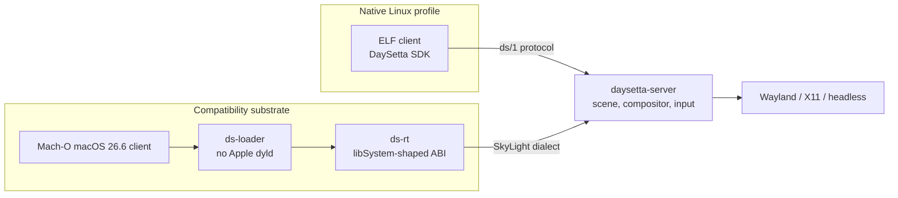

# DaySetta

DaySetta is the planned successor to **Daylight**, the open reimplementation of the
macOS window server. DaySetta is a clean-room macOS window-server and runtime layer
that does **not** depend on Apple's `dyld`, does **not** run inside Darling, and
targets two deployment profiles: **native Linux** and a DaySetta-owned
**compatibility substrate**.

> **Status: design only (M0).** Everything in this repository is `PLANNED` unless it
> cites existing Daylight evidence. Daylight citations describe the predecessor, not
> code that exists here.

## What Daylight established

Daylight is the evidence base. These are facts about the current system, with their
classes and sources.

| Fact | Evidence | Source |
|---|---|---|
| The private window-server protocol is SkyLight/CGX, with **738 MIG routines in 9 subsystems** | `VERIFIED` | `protocol/macos-26.6-x86_64.json`, `docs/knowledge/DAYLIGHT_OVERVIEW.md` |
| The Daylight server implements **15 handlers** and answers the rest from recorded replies | `IMPLEMENTED` | `docs/knowledge/api/mig-interface-catalog.md` |
| The handshake returns server version **600.0** with `logged_in = 1` | `IMPLEMENTED` | `docs/knowledge/TECHNICAL_DISCOVERIES.md` D-02 |
| The private bridge uses message ids **`0x44594c01`..`0xff`** | `IMPLEMENTED` | `daylight/docs/knowledge/api/ipc-interface-catalog.md` |
| The CA daemon registers **`com.apple.CARenderServer`** | `IMPLEMENTED` | `ca/daylight-ca.m`, `daylight/docs/knowledge/api/ipc-interface-catalog.md` |
| The catalog contains **4 878 453 exported symbols**: 303 841 on macOS 26.6 x86_64 and 4 574 612 on macOS 27 arm64e | `VERIFIED` | `data/apple-api/coverage.json` |
| macOS 27 Objective-C class and selector names are **unrecoverable offline** (0 names) | `VERIFIED` | `docs/knowledge/TECHNICAL_DISCOVERIES.md` D-20 |
| There is **no XPC** because there is no `launchd` in the guest | `VERIFIED` | `data/apple-api/xpc-interfaces.json` |
| Glass is approximated by a **solid 0.37-gray SDF fill**, not Apple's material | `PARTIAL` / `OBSERVED` | `TECHNICAL_DISCOVERIES.md` D-13, `DAYLIGHT_IMPLEMENTATION_STATUS.md` |
| Daylight runs inside Darling and uses a port of Apple's `dyld-1378` with a two-library override table | `VERIFIED` | `/home/ubuntu/DARLING-MACOS26-HANDOFF.md` |

## Why a successor

Daylight answered "can this be done?" It also inherited two structural couplings that
limit what can be built next.

| Coupling | What Daylight does today | Why DaySetta removes it |
|---|---|---|
| Apple loader | Uses Darling's `dyld-1378` port; only `libsystem_kernel` and `libdispatch` may be overridden (`VERIFIED`) | A window server should not depend on Apple's loader or its private patch table |
| Darling substrate | The server is a Mach service inside the Darling guest (`IMPLEMENTED`) | DaySetta is a Linux-native user-space stack; Mach-shaped IPC is library-level, not kernel-level |
| Client interposition | The bridge injects a dylib and swizzles `CAContext` / `CATransaction` (`IMPLEMENTED`) | Materials and events should be server capabilities, not client patches |

## Two profiles, one core

Both profiles use the same server core. The native profile speaks a DaySetta-owned
protocol; the substrate profile additionally speaks a SkyLight-shaped dialect.
Neither profile links Apple's `dyld`, and neither requires Darling.

## Design tenets

1. **Clean-room with respect to Apple.** Behaviour may be observed and documented;
   Apple code, binaries, private headers and disassembly are not copied.
2. **Own the loading path.** `ds-loader` loads ELF and Mach-O images without `dyld`.
3. **No Darling.** No XNU port, no `darlingserver`, no dylib extraction for execution.
4. **Protocol-first.** Every client-visible behaviour is defined in a versioned,
   testable protocol before it is implemented.
5. **One core, two profiles.** The compatibility substrate is an adapter, not a fork.
6. **Materials are compositor primitives.** Glass is evaluated by the server over a
   backdrop, not reconstructed from private client classes.
7. **Evidence or silence.** A claim without a class is a bug.
8. **Deterministic by default.** The CPU renderer is bit-reproducible; GPU results are
   compared with explicit tolerances.

## Repository map

| File | Purpose |
|---|---|
| `README.md` | Orientation, evidence base, rules |
| `VISION.md` | Problem, mission, users, success criteria |
| `ARCHITECTURE.md` | Processes, layers, memory, threading, failure model |
| `COMPONENT_MAP.md` | Components, interfaces, ownership, milestones |
| `PROTOCOL_STRATEGY.md` | Transport, codec, dialects, discovery, versioning |
| `RENDERING_STRATEGY.md` | Scene graph, CPU/GPU backends, materials, golden frames |
| `COMPATIBILITY_SCOPE.md` | Tiers, release matrix, exclusions |
| `MIGRATION_FROM_DAYLIGHT.md` | Feature-by-feature migration table |
| `ROADMAP.md` | Milestones M0–M6 with tests and exit criteria |
| `RISKS.md` | Risk register and mitigations |
| `TESTING.md` | Test levels, fixtures, conformance, CI |
| `DEPLOYMENT.md` | Profiles, packaging, operations, security |
| `GLOSSARY.md` | Terms used across the tree |
| `CONTRIBUTING.md` | Clean-room and review rules |
| `AI_AGENT_HANDOFF.md` | Short entry point for automated sessions |

## Reading order

For a first pass: `README.md` → `VISION.md` → `ARCHITECTURE.md` → `COMPONENT_MAP.md` →
`ROADMAP.md`. For protocol work add `PROTOCOL_STRATEGY.md` and
`MIGRATION_FROM_DAYLIGHT.md`. For the compatibility claim add
`COMPATIBILITY_SCOPE.md`, `RENDERING_STRATEGY.md` and `TESTING.md`.

## Evidence vocabulary

| Class | Meaning |
|---|---|
| `VERIFIED` | Reproduced by the project, or read directly from a binary artifact whose structure is documented |
| `IMPLEMENTED` | The behaviour exists in the Daylight tree and is reachable |
| `PARTIAL` | A usable subset exists; the rest is missing or approximated |
| `OBSERVED` | Seen at runtime or in a dump; mechanism not fully identified |
| `INFERRED` | A conclusion from stated indirect evidence |
| `UNKNOWN` | Open question; stated as a question |
| `PLANNED` | Intended for DaySetta; not implemented |

## Ground rules

* English, technical, no padding. Design docs stay between 80 and 200 lines.
* Diagrams use Mermaid; inventories use tables.
* No Apple API name is invented. Names come from the Daylight source, the catalog, or
  the handoff document.
* No Apple binaries, extracted dylibs, or proprietary headers are committed.
* Evidence is cited as `path:line` or as a named artifact.
* `AI_AGENT_HANDOFF.md` is the only document with a shorter length budget.

## Non-goals

DaySetta is not a full macOS reimplementation, not a replacement kernel, not a
distribution of Apple software, not an XPC/launchd replacement in its first releases,
and not a Metal implementation. See `COMPATIBILITY_SCOPE.md` for the exact boundary.

## Current state

M0 is the current milestone: contracts, evidence index, and repository hygiene. No
server, loader, or runtime code exists yet. `ROADMAP.md` defines the gates that must
pass before any runtime claim is made.
