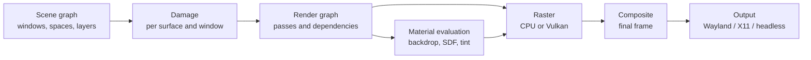
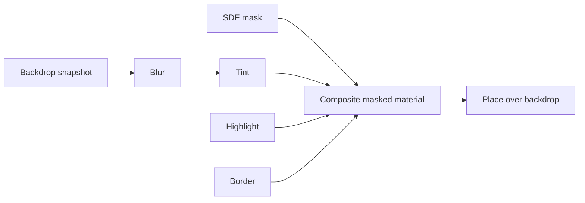

# Rendering Strategy

> Status: `PLANNED`. Rendering, materials and performance targets are intended
> DaySetta behaviour. Daylight rendering facts are cited as evidence.

## 1. Goals

| Goal | Measure |
|---|---|
| Deterministic reference output | CPU frames are bit-identical across runs and machines |
| Correct composition | Window ordering, clipping and opacity match the scene model |
| Materials as server primitives | Glass is evaluated from a backdrop, not a client bitmap |
| Bounded cost | Material work is attributable per frame and per window |
| Testable backends | Every backend passes the same render-graph tests |
| No Apple GPU stack | CPU first, Vulkan later, no Metal |

## 2. Pipeline

The render graph is built per frame from an immutable scene snapshot. A frame is a DAG
of passes; each pass declares reads and writes. The backend schedules passes, not the
other way round.

## 3. Scene representation

| Object | Contents | Ordering key |
|---|---|---|
| Space | Display assignment, active flag, windows | Space id |
| Window | Frame, level, visibility, owning client | Level, then commit order |
| Layer | Transform, opacity, clip, corner radius, contents | Tree order |
| Surface | Buffer slots, format, damage, sequence | Surface epoch |
| Material | Kind, parameters, backdrop scope | Render-graph dependency |

Daylight composited canvases by **window level, then flush order** (`IMPLEMENTED`,
commit `a9545d4`). DaySetta keeps that semantic but records commit order as an explicit
monotonic field instead of inferring it from arrival time. Tie-breaking must never
depend on thread scheduling.

## 4. Backends

| Backend | Target | Status | Use |
|---|---|---|---|
| CPU reference | Any Linux host | `PLANNED` M2 | Golden frames, CI, fallback |
| Vulkan | Linux GPU | `PLANNED` M5 | Interactive performance |
| Headless | CI and capture | `PLANNED` M2 | PNG/PPM frame dumps |
| X11 | Existing desktops | `PLANNED` M2 | Output and development |
| Wayland | Modern Linux desktops | `PLANNED` M2 | Primary interactive output |
| DRM/KMS | Dedicated sessions | `UNKNOWN` | Only if a concrete need appears |

The backend interface is `prepare(snapshot) → execute(passes) → present(frame)`. A
backend that cannot honour a pass must fail the frame, not silently drop the effect.

## 5. Materials

Daylight's glass investigation is the design input. Apple's Dock floor is a
`CASDFLayer`, `renderInContext:` does not draw it, and the material is produced by a
software SDF scan-converter (`OBSERVED`, D-13). Daylight's fallback is an
`effect fill (color (0.37 0.37 0.37 1 0))` (`OBSERVED`, D-13). A compositor-level
`glass_draw()` later implemented backdrop blur, tint, highlight and border
(`OBSERVED`, `/home/ubuntu/DARLING-MACOS26-HANDOFF.md`), but the project still classifies
glass as `PARTIAL` overall.

DaySetta makes that compositor-level approach the architecture, not a workaround.

| Material stage | Input | Output | Notes |
|---|---|---|---|
| Backdrop capture | Composited region below the material | Backdrop texture | Must exclude the material's own output |
| Backdrop filter | Backdrop texture, radius | Blurred backdrop | Separable blur; radius in logical pixels |
| Shape mask | Rounded-rect or path, corner radius | Coverage mask | Analytic SDF, antialiased |
| Tint | Colour, opacity | Tinted backdrop | Linear-light blending |
| Highlight | Edge normals, light direction | Edge light | Deterministic, no noise |
| Border | Shape, width, colour | Border | Clipped to mask |

This is explicitly **not** a claim of bit-exact Apple glass. Success is defined as
structural parity plus a perceptual threshold on a fixed scene corpus. The old 0.37-gray
fill becomes a documented "material floor" used only when a backend cannot evaluate the
material.

## 6. SDF model

| Property | Rule |
|---|---|
| Shapes | Rounded rectangle, circle, arbitrary path mask |
| Distance | Signed, negative inside, measured in logical pixels |
| Antialiasing | Analytic coverage from distance and pixel footprint |
| Corner continuity | Circular arcs only in M5; squircle research later |
| Composition | Union and intersection of masks; no implicit blur |
| Precision | Float32 in the reference path; backend may use Float16 only with tolerance |

A shape is data, not code. Clients may submit a path or a rounded-rect descriptor; they
may not submit a shader or a private class reference.

## 7. Colour

| Topic | Decision | Status |
|---|---|---|
| Working space | Linear-light RGB, float32 | `PLANNED` |
| Native surface default | Premultiplied BGRA8888 | `PLANNED` |
| Output | sRGB by default; Display P3 when the backend reports it | `PLANNED` |
| HDR | Out of scope through M6 | `PLANNED` |
| Alpha | Premultiplied at every API boundary | `PLANNED` |
| ICC | Backend-provided, not parsed by the server in M2 | `PLANNED` |

## 8. Pacing and damage

Daylight's realtime display block carries a **16 666 667 ns** period in a 4 096-byte
shared block (`VERIFIED`, D-09). DaySetta treats that as a compatibility value for the
SkyLight dialect; the native display model reports refresh rate and frame counters and
lets the output backend drive presentation.

| Rule | Reason |
|---|---|
| Damage is conservative on first frame and after resize | Avoid stale pixels |
| Occluded windows are not rendered unless material needs their backdrop | Bound cost |
| A frame may be dropped, never partially presented | Atomic presentation |
| Frame-done carries the presented sequence | Clients can throttle correctly |
| Material passes are attributed per node | Cost is measurable |

## 9. Determinism and golden frames

| Level | Guarantee | Test |
|---|---|---|
| CPU reference | Bit-identical output | SHA-256 of frame |
| CPU multithreaded | Deterministic tile merge | Hash across 1, 2, 8 threads |
| Vulkan | Tolerance-based | Per-pixel delta and perceptual metric |
| Headless | Stable file naming and metadata | Manifest hash |

Golden scenes are synthetic: rectangles, gradients, text-shaped placeholders and
material panels. Apple screenshots are not committed unless redistribution is cleared;
reference captures stay outside the repository and are cited by checksum.

## 10. Performance targets

These are `PLANNED` targets, not measurements.

| Metric | Target | Milestone |
|---|---|---|
| 1920×1080, 20 windows, CPU | 60 Hz with p99 frame under 16.6 ms | M6 |
| Idle desktop, CPU | Under 5 % of one core | M6 |
| Glass panel, 800×600 | Under 4 ms on the reference CPU | M5 |
| Damage-only frame | Under 2 ms at 1080p | M4 |
| Memory per 1080p surface | 8 MiB at BGRA8888, plus 2 slots | M2 |

Targets are revised only by an ADR with measurements attached. A missed target is
reported, not hidden by reducing the scene.

## 11. Metrics

| Metric | Where | Use |
|---|---|---|
| Frame time p50/p95/p99 | Server counters | Regression detection |
| Damage ratio | Render graph | Overdraw diagnosis |
| Material cost per node | Render graph | Glass budgeting |
| Dropped frames | Output backend | Pacing correctness |
| Surface age at sample | Surface pool | Tearing and stalls |
| Backend fallback count | Server counters | Reliability |

## 12. Non-goals

* Bit-exact Apple `CASDF` output or shader reproduction.
* Metal, MetalKit, or Apple GPU driver interfaces.
* HDR, wide-gamut authoring, or colour management beyond backend reporting.
* Client-supplied shaders or arbitrary GPU programs.
* GPU rendering in M2 or M3. The reference path is CPU.

## 13. Open questions

| Question | Class | Settles at |
|---|---|---|
| Is separable blur sufficient for the material threshold? | `UNKNOWN` | M5 material study |
| Which Vulkan formats preserve premultiplied BGRA without a copy? | `UNKNOWN` | M4 backend prototype |
| Do we need damage regions in the native protocol or only rectangles? | `UNKNOWN` | M2 scene tests |
| How is text supplied without Apple fonts? | `UNKNOWN` | M5 font ADR |
| Can the CPU path hold 60 Hz with material panels? | `UNKNOWN` | M6 benchmark |
