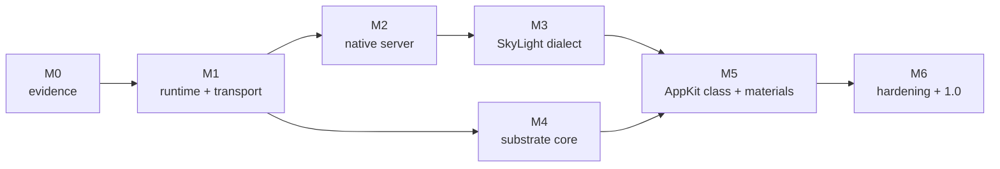

# Roadmap

> Status: `PLANNED`. Milestones are cumulative. Dates are deliberately omitted: a
> milestone closes when its exit criteria pass, not when a calendar says so.

## 1. How to read this roadmap

Each milestone has an **objective**, a task list, the **tests** that must exist, the
**acceptance** result, and the **exit criteria** that close it. Evidence from a later
milestone cannot satisfy an earlier gate. A milestone that loses a dependency is marked
blocked, not silently skipped.

| Milestone | Theme | Single exit sentence |
|---|---|---|
| M0 | Evidence and contracts | A claim can be traced to a class and a source |
| M1 | Runtime and transport | A native client talks to a broker-owned endpoint |
| M2 | Native window server | Two native clients share a deterministic desktop |
| M3 | SkyLight dialect | Recorded traces replay with typed outcomes |
| M4 | Substrate core | A Mach-O fixture runs without Apple `dyld` |
| M5 | AppKit class and materials | One narrow AppKit-shaped app draws and responds |
| M6 | Hardening and 1.0 | Installable, measured, audited, documented |

## 2. M0 — Evidence and contracts

**Objective.** Turn Daylight's knowledge into a versioned evidence base and a set of
testable contracts, without writing runtime code.

**Tasks.**
* Create the evidence index: protocol JSON, traces, catalog artifacts, handoff notes.
* Define schemas for endpoints, messages, surfaces, commits, events and traces.
* Write ADRs for language choice, input backend, ObjC runtime source and font policy.
* Stand up CI for link checks, schema validation, line budgets and binary rejection.
* Port the catalog reader under a licence review; pin artifact checksums.
* Write the threat model and the compatibility claim registry.

**Tests.** Document link check; JSON schema validation; catalog checksum reproduction;
repository scan for binaries and Apple dylibs; line-count check for design docs.

**Acceptance.** Every design claim has an evidence class; the protocol baseline parses;
the evidence index resolves every cited path; CI is green on a clean checkout.

**Exit criteria.** M0 review signed off; no blocking ADR; the migration table has an
owner and a status for every Daylight feature.

## 3. M1 — Runtime and transport

**Objective.** Provide the smallest end-to-end path: an ELF client resolves an endpoint
through the broker and exchanges messages with the server.

**Tasks.**
* Implement `ds-ipc` framing, handles, rights, `SCM_RIGHTS` passing and peer checks.
* Implement `daysetta-broker` registration, lookup, revocation and audit records.
* Implement `ds-loader` ELF loading and a Mach-O reader that maps but does not execute.
* Bring up `ds-rt` initialization and `ds-observability` structured logs.
* Add `ds-config`, `ds-security` hooks and `daysetta-ctl` skeleton.
* Build a native hello client and a loopback echo server.

**Tests.** Unit tests for header parsing and handle tables; round-trip fuzz; malformed
size/count/alignment corpus; peer-credential spoof attempts; loader fixture parsing;
1 000 000-message loopback with leak and fd-count checks.

**Acceptance.** Hello client resolves `org.daysetta.server`, exchanges messages, and
exits 0; a Mach-O fixture is parsed correctly; no process links Apple `dyld` or Darling.

**Exit criteria.** Demo recorded; fuzz corpus runs clean for 24 hours; security review
of handle lifetime and fd passing is closed.

## 4. M2 — Native window server

**Objective.** Serve a native desktop: windows, surfaces, input, CPU compositing and a
real output backend.

**Tasks.**
* Implement `ds-scene` windows, spaces, levels, ordering and notes.
* Implement `ds-surface` slot pools, damage and sequence validation.
* Implement `ds-compositor` and the CPU reference backend.
* Implement `ds-input` for pointer, keyboard, scroll and activation.
* Implement Wayland, X11 and headless outputs plus `ds-display` frame pacing.
* Ship `ds-sdk`, `daysetta-session`, `daysetta-ctl` and an optional `ds-shell`.

**Tests.** Golden frames for a fixed scene; ordering by level and commit sequence;
resize and occlusion; input targeting and grab; surface sequence gaps; ASan/UBSan runs;
an 8-hour soak with client churn.

**Acceptance.** Two native clients create windows, draw, resize and receive input;
frames are bit-identical across 1, 2 and 8 render threads; no fd or memory growth in
the soak.

**Exit criteria.** T0 acceptance suite published; performance baseline recorded; the
renderer and scene APIs are frozen for M3.

## 5. M3 — SkyLight dialect

**Objective.** Serve the macOS 26.6 SkyLight-shaped protocol from recorded evidence,
without canned replies in production.

**Tasks.**
* Implement the descriptor/NDR codec and the 9-subsystem routing table.
* Port the handshake constants and the 15 Daylight-modelled routines semantically.
* Implement session notes `0x390`, `0x391`, `0x33b` and the event delivery shape.
* Build the trace replay harness and normalize ports, pids and timestamps.
* Classify every routine as `modelled`, `explicit-unsupported` or `fixture-only`.
* Generate the compatibility audit report.

**Tests.** Replay of the recorded 57-routine trace (370 calls, `OBSERVED`); unknown-id
corpus across all ranges; malformed descriptor corpus; differential checks against
recorded reply sizes; endianness variants; 738-routine coverage report.

**Acceptance.** Recorded traces replay with the same operation sequence and typed
outcomes; all 15 modelled routines pass conformance; no production path returns a
recorded opaque blob.

**Exit criteria.** Conformance report published; T2 protocol shape demonstrated; the
remaining unsupported list is accepted by review.

## 6. M4 — Compatibility substrate

**Objective.** Load and run a non-GUI Mach-O fixture without Apple `dyld` and without
Darling.

**Tasks.**
* Complete `ds-loader` Mach-O mapping, binding, relocations and TLS.
* Implement `ds-rt` libSystem-shaped calls from a measured import census.
* Provide an Objective-C runtime and the required metadata handling.
* Implement pthread, TLS, time, memory, file and socket surfaces for E0/E1.
* Implement a libdispatch subset sufficient for the fixture set.
* Add bootstrap translation, crash notes and a syscall conformance layer.

**Tests.** ABI and calling-convention suite; ObjC class/selector resolution; thread and
TLS stress; syscall conformance; negative tests for missing symbols; import census
diff against the fixture set; no-Darling and no-Apple-dyld scans.

**Acceptance.** E0 fixture exits 0; E1 fixture performs file, thread and time work; no
Apple `dyld` is mapped; no Darling library is linked; crash diagnostics are actionable.

**Exit criteria.** E0/E1 published; security review of the loader closed; the T2
envelope is updated with measured gaps.

## 7. M5 — AppKit class and materials

**Objective.** Run one narrow AppKit-shaped macOS 26.6 client on the substrate and
render it with a first-class material model.

**Tasks.**
* Implement the commit adapter and surface import for the compatibility path.
* Map window lifecycle, activation and input to `ds-scene` and `ds-input`.
* Implement the `ds-material` graph: backdrop, blur, tint, highlight, border.
* Resolve the font and text policy; implement the chosen path.
* Build the reference comparison and perceptual material test.
* Publish the E2 unsupported list.

**Tests.** Single-window draw and interaction; resize and occlusion; material structural
tests; perceptual threshold on a synthetic panel; golden manifest; frame-time benchmark;
private-API scan to prove no ivar reads.

**Acceptance.** E2 fixture creates a window, draws content, and responds to pointer and
keyboard; material passes the agreed threshold; the runtime contains no `CASDFLayer`,
`CASDFGenerator`, `CARenderShow` offset or `_sdfElementContents` dependency.

**Exit criteria.** E2 demo recorded; limitations published; risk review accepts the
remaining gap between the 0.37-gray floor and the material model.

## 8. M6 — Hardening and 1.0

**Objective.** Make the system installable and measurable, and freeze the first stable
protocol.

**Tasks.**
* Add multi-display topology and hot-plug, or formally defer with a published gap.
* Optimise the CPU path and integrate the Vulkan backend behind a feature flag.
* Package server, broker, session, SDK and tools; add upgrade and rollback.
* Complete the security model: capabilities, fd hygiene, fuzz coverage, audit.
* Freeze `ds/1` major 1 and publish the compatibility audit format.
* Research the macOS 27 protocol delta; do not claim runtime support.

**Tests.** Long soak and fault injection; upgrade/rollback; security regression; E3
scenario suite; 1080p/20-window benchmark; clean-VM install; documentation audit.

**Acceptance.** Published SLOs are met or explicitly waived; no open P0; every release
artifact is reproducible; the audit file matches the test run; docs cover every
component and exclusion.

**Exit criteria.** 1.0 release candidate tagged; external review complete; the next
protocol major has a written compatibility policy.

## 8a. Third-party app install paths (owner order, 2026-11-08; after the desktop and the built-in macOS 27 apps run)

Status: not started. The first deliverables of the third-party phase, before any per-app tuning:

1. `.app` in a `.dmg`: mount disk images the way macOS does (DiskImageMounter, `hdiutil`, diskimages-helper; APFS and HFS+ images), then drag to /Applications in Finder.
2. `.pkg`: Installer.app and the PackageKit stack (installd, system_installd, pre/postinstall scripts, receipts in /var/db/receipts).
3. Then app-by-app work (Office, Chrome, VS Code, Discord, ...). Very special-purpose apps may be skipped.

## 8b. Final humanize pass (owner order, 2026-11-08; when the app is close to done)

One full cleanup pass over every repo we own (~/daysetta, our Darling commits, dyl4, the windowserver), behaviour-preserving and test-gated:
`/deslop repo` (clean-code-skill) slice by slice, a code-humanizer scan with fixes, and `desloppify scan` + `next` per project until the strict score stops improving. During development every agent already writes under the mandatory clean-code + code-humanizer Guard rules (~/.config/opencode/AGENTS.md).

## 9. North Star (not started)

Status: `PLANNED`, no work done, no commitments, no claims. Vision in the user's words:
a desktop window app where the user drags a macOS IPSW into it, it extracts automatically,
and the macOS desktop appears inside that window, used like a real macOS VM. Later also
running macOS apps on x86_64 hosts and on arm hosts.

Open questions only (`UNKNOWN` until answered):

* Host/guest architecture matrix: which host (Linux x86_64, Linux arm64, macOS) with which
  guest (macOS arm64, macOS x86_64), and which pairs are in scope at all.
* How the guest display reaches the window, and how that relates to the DaySetta scene and
  capture path.
* Apple's macOS license limits on where virtualization is allowed.
* IPSW handling: source, extraction, storage, integrity checks.
* Ahead-of-time translation vs interpreter plus JIT vs dynamic translation for the app case;
  see `docs/REF_ARM_TRANSLATORS.md` for what two public translators state.
* How a bridge to host system libraries would work when the host is Linux, where no macOS
  libraries exist to bridge to.
