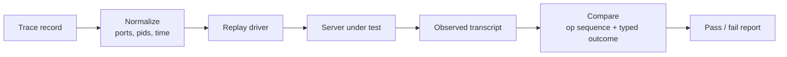
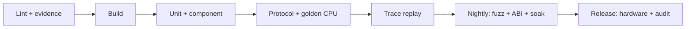

# Testing

> Status: `PLANNED`. The test system is design intent. Daylight test results are cited
> as evidence of what the predecessor achieved, not as DaySetta results.

## 1. Principles

| Principle | Consequence |
|---|---|
| Test the contract, not the implementation | Protocol tests use transcripts and schemas |
| Evidence is an input | Traces and catalog artifacts are fixtures, checksummed |
| No Apple bits in CI | Fixtures are synthetic or user-supplied with a provenance record |
| Determinism is a feature | CPU frames are hashed; GPU frames use tolerance |
| Failure is data | Every rejection has a typed reason and an audit record |
| A claim needs a test | No tier, material or performance claim without a report |

## 2. Test levels

| Level | Name | Scope | Runs |
|---|---|---|---|
| L0 | Evidence lint | Citations resolve, classes present, no invented API names | Every commit |
| L1 | Unit | Parsers, handle tables, allocators, math, SDF | Every commit |
| L2 | Component | Scene, surface pool, input routing, render graph | Every merge |
| L3 | Protocol conformance | Codec, dialect routing, errors, version gate | Every merge |
| L4 | Trace replay | Recorded Daylight traffic normalized and replayed | Nightly |
| L5 | Golden image | CPU frames, material panels, backend parity | Every merge |
| L6 | Substrate ABI | Mach-O loading, libSystem shims, ObjC, threads | Nightly |
| L7 | Soak and fault | Leaks, fd churn, client death, backend loss | Weekly |
| L8 | Hardware | Real Wayland/X11, GPU, multi-display | Release candidate |

## 3. Fixtures and provenance

| Fixture | Contents | Committed | Provenance |
|---|---|---|---|
| Synthetic messages | Generated from the IDL | Yes | Generator and seed |
| Protocol transcripts | Normalized request/reply sequences | Yes, if sanitized | Source trace checksum |
| Daylight bridge traffic | `0x44594c01..ff` translated records | Test-only | External artifact |
| Mach-O fixtures | Small binaries built for the test | Yes, if self-built | Build recipe |
| macOS binaries | AppKit apps, dylibs, caches | **No** | User-supplied at run time |
| Fonts | Any Apple font | **No** | Never |
| Reference screenshots | Captures from a real Mac | Only with clearance | Checksum and licence note |

A fixture without provenance is removed. A test that silently downloads Apple artifacts
is a release blocker.

## 4. Protocol conformance

| Check | Rule |
|---|---|
| Operation sequence | Must match, except declared non-deterministic operations |
| Reply shape | Field presence and size class must match |
| Error class | Must match the documented mapping, not the literal Mach code |
| Timing fields | Normalized away unless the test targets pacing |
| Unknown ids | Must return the documented unsupported error |
| Partial replies | Never allowed; the operation is atomic |

The comparison ignores absolute ports and timestamps by design. A test that depends on
a kernel-assigned value is a broken test.

## 5. Golden images

| Scene | Contents | Comparison |
|---|---|---|
| `basic-windows` | Three overlapping windows, solid colours | Exact SHA-256 on CPU |
| `damage` | Partial invalidation and scroll | Exact on CPU; delta on GPU |
| `material-panel` | Glass over a gradient backdrop | Structural and perceptual |
| `texture` | Checkerboard, gradients, alpha | Exact on CPU |
| `stress` | 20 windows, mixed levels | Exact on CPU; p99 timing |

A golden update requires: the renderer version, the reason, the old and new hashes, and
a reviewer. Updating a golden to make a failing test pass is prohibited without that
record.

Material tests report separate metrics: blur radius estimate, tint delta, border
coverage, highlight presence, and a perceptual score. A single aggregate score hides
which stage regressed.

## 6. Fuzzing

| Target | Corpus | Invariant |
|---|---|---|
| Message header | Random sizes, flags, counts | No OOB read, no allocation above cap |
| Descriptor/NDR parser | Truncation, bad alignment, nested counts | Reject with typed error |
| Handle table | Duplicate, stale, cross-session handles | Deny and audit |
| Surface metadata | Huge dimensions, stride overflow, bad format | Reject before mapping |
| IDL decoder | Random field order and lengths | No crash, no partial state |
| Loader | Truncated Mach-O, bad load commands | Bounded failure, no execution |
| Trace normalizer | Malformed records | Reject, never silently rewrite |

Fuzz targets run in CI with a time budget and nightly with a longer budget. A crash
becomes a regression test before it becomes a fix.

## 7. Substrate ABI tests

| Test | Checks |
|---|---|
| Calling convention | Integer, float, struct return, varargs |
| TLS | Thread creation, destruction, initial-exec and local-exec models |
| Objective-C | Class lookup, selector dispatch, categories, protocols |
| Memory | `malloc` alignment, `mmap` semantics, guard pages |
| Threads | `pthread_create`, mutex, condition, once, key destructors |
| Time | Monotonic clock, wall clock, timers |
| Files | `open`, `stat`, `read`, `write`, `rename`, directory iteration |
| Sockets | `socketpair`, `connect`, `poll`, `shutdown` |
| Dispatch | Queues, groups, semaphores, timers, workloop subset |

An ABI test that passes on one fixture and fails on another is a scope signal, not a
test bug.

## 8. Environments

| Environment | Purpose | Apple artifacts | Network |
|---|---|---|---|
| Developer Linux | L1–L3, L5 CPU | None | Optional |
| CI Linux | L1–L6, headless | None | Isolated |
| GPU runner | Vulkan parity | None | Isolated |
| Substrate runner | L6 with user-supplied Mach-O | User-supplied, never stored | Isolated |
| Reference Mac | Capture new evidence | Yes, outside repo | Controlled |
| Clean VM | Install, upgrade, rollback | None | Optional |

## 9. CI pipeline

Stages are fail-closed. A skipped stage is visible in the report and blocks a tier
claim. Nightly failures open a tracking issue with the failing seed and artifact hash.

## 10. Performance testing

| Benchmark | Metric | Gate |
|---|---|---|
| Idle desktop | CPU percentage, wakeups | No regression over 5 % |
| 1080p, 20 windows | p50/p95/p99 frame time | Published SLO |
| Glass panel | Material pass time | Under budget or waived |
| Client churn | fd count, RSS | Flat over 8 hours |
| Input latency | Event to present | Reported, not gated until M6 |

Performance results include the machine, kernel, driver, renderer and scene hash.
Without that tuple, a number is not comparable.

## 11. Definition of done

A feature is done when: its contract is documented; its tier is named; unit and
component tests exist; a conformance or golden test proves the visible behaviour; the
unsupported cases are listed; and the audit file can be regenerated from the run.

## 12. Reporting failures

A failure report includes the evidence class, the fixture, the command, the expected
and observed transcripts, the renderer or runtime version, and the artifact checksums.
"Does not work" is not a report. A report that requires an Apple binary must say where
the user obtained it and must not attach it.

## 13. Known gaps

| Gap | Class | Effect |
|---|---|---|
| No automated guest regression in Daylight | `PARTIAL` | Trace replay must substitute for a live guest |
| macOS 27 ObjC metadata unavailable | `VERIFIED` | No 27 class-level test is possible |
| No GPU CI yet | `PLANNED` | Vulkan parity is release-candidate only |
| Material metric not validated against users | `UNKNOWN` | Threshold is provisional |
| Font test corpus unresolved | `UNKNOWN` | Text golden tests wait on the font ADR |
