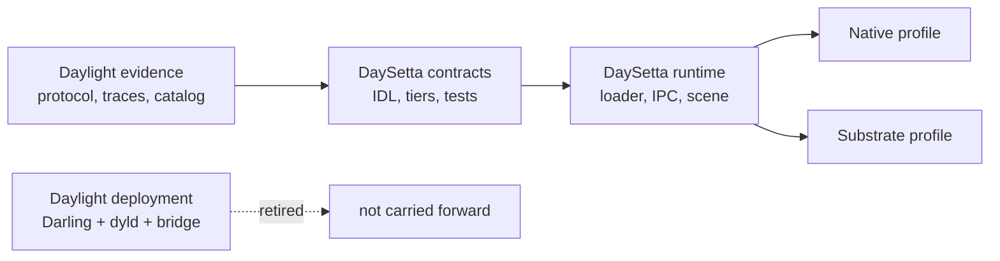

# Vision

> Status: `PLANNED`. This document states intent. Daylight citations are evidence about
> the predecessor, not claims about DaySetta code.

## 1. Vision statement

A window server and runtime layer for macOS-shaped clients that runs on Linux without
Apple's loader and without Darling: small enough to audit, explicit enough to test, and
honest enough to say which parts of macOS it does not reproduce.

## 2. The problem

Daylight proved that an open implementation of the private SkyLight window-server
protocol can drive real AppKit clients. It also exposed three problems that cannot be
fixed inside the old architecture.

| Problem | Evidence | Consequence |
|---|---|---|
| **Loader coupling** | Daylight needs Darling's `dyld-1378` port and Apple's patch table; only `libsystem_kernel` and `libdispatch` may be overridden (`VERIFIED`, `DARLING-MACOS26-HANDOFF.md`) | The runtime inherits Apple's loading model and Darling's repair burden |
| **Substrate coupling** | The server is a Mach service inside the Darling guest (`IMPLEMENTED`, `DAYLIGHT_ARCHITECTURE.md`) | Every porting fix is a kernel-emulation fix, not a server fix |
| **Private-ABI coupling at the client** | The bridge injects a dylib, swizzles `CAContext` / `CATransaction`, and reads `_sdfElementContents` (`IMPLEMENTED`, `daylight/docs/knowledge/api/private-api-research.md`) | Correctness depends on release-specific class layouts |
| **Material gap** | Apple's glass is a `CASDFLayer` evaluated by a software SDF scan-converter; Daylight falls back to a solid 0.37-gray fill (`PARTIAL` / `OBSERVED`, D-13) | The most visible modern UI feature is approximated, not implemented |

The lesson is not "try harder inside Darling". The lesson is that the window server,
the loader, and the material model must be designed together, with the Linux platform
as the base rather than as an emulated Mac kernel.

## 3. Mission

Build a server that:

* owns its scene graph, compositor, input routing, display state and material
  evaluation;
* speaks a documented native protocol, plus a SkyLight-shaped dialect for
  compatibility;
* loads clients with `ds-loader`, never Apple `dyld`;
* runs as an ordinary Linux user process, never inside Darling;
* can be tested from recorded evidence without Apple binaries in the loop.

## 4. Who it is for

| User | Need | What DaySetta offers |
|---|---|---|
| Window-server researcher | A readable implementation of the SkyLight role | Declarative subsystem tables and a conformance harness |
| Linux desktop integrator | A compositor with macOS-shaped semantics | Native `ds/1` protocol and public-shaped scene model |
| Compatibility engineer | A path for unmodified macOS 26.6 binaries | A substrate profile with a documented coverage boundary |
| Protocol archaeologist | Replayable evidence | Trace format, catalog readers, golden transcripts |
| Automated agent | Stable entry points and rules | `AI_AGENT_HANDOFF.md`, evidence schema, milestone gates |

## 5. Design principles

| Principle | What it requires | Anti-pattern it rejects |
|---|---|---|
| Clean-room | Observe behaviour; reimplement from documentation and traces | Copying disassembly or Apple source into the tree |
| No Apple loader | `ds-loader` resolves Mach-O and ELF itself | Linking `dyld` or reusing cache dylibs as runtime inputs |
| No Darling | Linux syscalls and user-space IPC only | Modifying XNU or shipping `darlingserver` |
| Protocol-first | An IDL and transcript for every client-visible op | Adding handlers ad hoc until a client stops crashing |
| One core, two profiles | Compatibility is an adapter at the protocol edge | Forking the server for the substrate |
| Explicit materials | Backdrop, blur, tint, highlight, border are server ops | Reading private `CASDFLayer` ivars |
| Evidence or silence | Every claim has a class and a source | "It should work" as a status |
| Deterministic by default | CPU path is bit-reproducible | Untracked GPU-only output |

## 6. What success looks like

These are `PLANNED` acceptance targets, not current results.

| ID | Criterion | Measure | Milestone |
|---|---|---|---|
| V1 | A native Linux client creates, resizes and draws a window | End-to-end test on the CPU renderer | M2 |
| V2 | Two native clients share one desktop with correct ordering | Golden frame plus input-routing test | M2 |
| V3 | The SkyLight 26.6 dialect replays the recorded Daylight traces | Trace replay with normalized ports and timestamps | M3 |
| V4 | A non-GUI Mach-O fixture runs without Apple `dyld` | ABI suite and syscall conformance | M4 |
| V5 | A narrow AppKit-shaped client draws and receives input on the substrate | Interaction test and reference comparison | M5 |
| V6 | Glass is a first-class compositor material | Structural and perceptual material tests | M5 |
| V7 | A 1080p, 20-window scene holds 60 Hz on the reference CPU | Benchmark with p99 frame time reported | M6 |
| V8 | A release can be installed and rolled back as a normal Linux service | Deployment test in a clean VM | M6 |

## 7. Non-goals

* A complete macOS userland, kernel, or driver stack.
* Running Apple's WindowServer, `launchd`, or XPC services.
* Redistributing Apple binaries, fonts, frameworks, or extracted dylibs.
* Bit-exact reproduction of Apple's SDF shader or GPU pipeline.
* A Metal API implementation in the first release.
* macOS 27 runtime compatibility. The 27 catalog is comparison evidence only, because
  its Objective-C names are not recoverable offline (`VERIFIED`, D-20).

## 8. Relationship to Daylight

DaySetta inherits Daylight's **knowledge**, not its deployment model. The protocol
inventory, implementation status, technical discoveries, private-API research, trace
format, and catalog pipeline are the starting evidence. The Darling integration, the
injected bridge, the canned-reply strategy, and the private-ivar reads are migration
inputs, not foundations.

## 9. What would change this vision

| Challenge | Why it matters | Response if true |
|---|---|---|
| The SkyLight dialect cannot be served without Apple code | The compatibility premise fails | Narrow the claim to native profile and published traces |
| The substrate cannot run even a CLI Mach-O fixture | T2 is not viable | Keep T2 as research; ship T0/T1 |
| Material fidelity needs GPU features unavailable on Linux | Visual parity is limited | Define a documented material floor and test it structurally |
| Clean-room constraints forbid reading the evidence we have | The catalog cannot be used | Rebuild evidence from public behaviour only; reassess scope |

## 10. Horizon

Near term: a native server with deterministic rendering and a replayable SkyLight
dialect. Mid term: a narrow substrate for macOS 26.6 x86_64 clients and a real material
model. Long term: a stable protocol other implementations can target, with the
compatibility boundary published as data rather than as prose.
